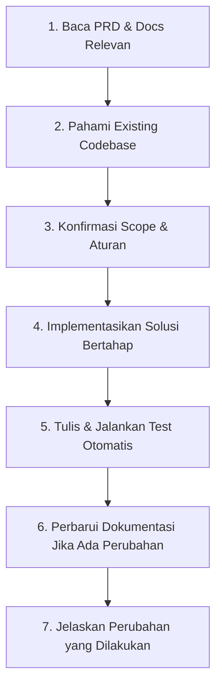

# AGENTS.md: Developer & AI Coding Agent Operating Manual

**Proyek:** Multi-Platform General-Purpose AI Assistant (Web & Telegram)  
**Versi:** 1.0  
**Tanggal:** 7 November 2026  
**Status Dokumen:** Mandatori untuk seluruh AI Coding Agent dan Pengembang Manusia

---

## 1. Project Overview

Proyek ini adalah asisten kecerdasan buatan serba guna (*general-purpose AI assistant*) yang dapat diakses melalui dua platform: **Web Application (SPA)** dan **Telegram Bot**.
- Kedua antarmuka berbagi satu backend terpadu (**Shared Backend**).
- Menggunakan pendekatan **API-First** dan arsitektur orkestrasi AI modular dengan **Model Abstraction Layer**.
- Prioritas MVP menggunakan API model AI eksternal (multi-provider: minimal 2 adapter aktif).
- Seluruh spesifikasi bisnis dan teknis berakar pada dokumen resmi di dalam folder `docs/`.

---

## 2. Core Architecture Principles

1. **Shared Backend & Single Source of Truth:** Dilarang menduplikasi *business logic* atau aturan AI antara Web dan Telegram. Handler Telegram dan controller Web hanyalah lapisan tipis (*thin consumer layer*) di atas modul domain bersama (`ConversationService`, `AIOrchestrator`).
2. **Modular Monolith First:** Gunakan arsitektur monolit modular di Node.js Fastify. Jaga pemisahan modul secara ketat (*strict domain boundaries*). Dilarang memecah menjadi arsitektur microservices tanpa persetujuan arsitek.
3. **Stateless Compute:** Backend tidak menyimpan status sesi di memori proses (RAM). Sesi dikelola di Redis dan database PostgreSQL untuk mendukung skalabilitas horizontal.
4. **Vendor-Neutral AI Abstraction:** Seluruh pemanggilan model LLM wajib melalui `AIProviderAdapter`. Jangan pernah mengimpor SDK vendor AI secara langsung ke dalam controller atau service percakapan.

---

## 3. Technology Stack Reference

- **Backend:** Node.js (LTS v20+), Fastify, TypeScript (Strict Mode).
- **Frontend:** React 18+, Vite, TypeScript, Tailwind CSS, Radix UI Primitives, Lucide Icons, Zustand, TanStack Query.
- **Telegram Bot:** grammY (TypeScript).
- **Database:** PostgreSQL 15+ dengan Prisma ORM / Drizzle ORM.
- **Cache & Rate Limit:** Redis 7+ (`ioredis`).
- **Autentikasi & Keamanan:** Argon2id, Session Cookies HttpOnly SameSite=Strict, DOMPurify.

---

## 4. Project Directory Structure

```
d:/project/Chatbot-YAR/
├── docs/                        # Dokumentasi Resmi Proyek
│   ├── 01-product/              # PRODUCT-OVERVIEW, USER-STORIES, USER-FLOW
│   ├── 02-technical/            # TDD, SYSTEM-ARCHITECTURE, DATABASE-ERD, API-SPECIFICATION, SECURITY
│   ├── 03-design/               # UI-UX-SPECIFICATION, DESIGN-SYSTEM
│   ├── 04-ai/                   # AI-BEHAVIOR, MODEL-STRATEGY, AI-ORCHESTRATION
│   ├── 05-development/          # DEVELOPMENT-ROADMAP, TASKS, CODING-STANDARDS, TEST-PLAN
│   ├── 06-operations/           # DEPLOYMENT, MONITORING
│   ├── TRACEABILITY-MATRIX.md   # Matriks penelusuran requirement
│   └── DOCUMENTATION-REVIEW.md  # Laporan review dokumentasi
├── AGENTS.md                    # File Instruksi Ini
└── Product Requirements Document (PRD).md # PRD Asli (Single Source of Truth)
```

---

## 5. Coding & Naming Standards

1. **Files:** Backend menggunakan `kebab-case.ts` (misal: `context-builder.ts`); Komponen React menggunakan `PascalCase.tsx` (misal: `ChatViewport.tsx`).
2. **Code Symbols:** Class & Interface `PascalCase`; Method & Variabel `camelCase`; Konstanta global `UPPER_SNAKE_CASE`.
3. **Database & API:** Kolom database dan key JSON request/response wajib `snake_case`. URL route `kebab-case` jamak (misal: `/v1/conversations`).
4. **Strict TypeScript:** Tidak ada tipe `any`. Jika data dinamis, gunakan `unknown` dengan validasi skema (Zod/TypeBox).
5. **No Speculative Coding (YAGNI):** Jangan mengimplementasikan fungsi di luar task yang sedang dikerjakan.

---

## 6. Security & Database Rules

1. **Zero Secret Leakage:** Dilarang keras mengekspos kunci API, token bot, atau kredensial database ke sisi klien, log aplikasi, atau repositori git.
2. **User Data Isolation (Multi-Tenant Guard):** Setiap kueri database untuk percakapan atau pesan WAJIB menyertakan klausul `WHERE user_id = :authenticated_user_id AND deleted_at IS NULL`. Jangan pernah membiarkan pengguna mengakses data milik pengguna lain.
3. **Soft Delete Policy:** Penghapusan percakapan dan akun menggunakan `deleted_at`. Data yang telah di-soft-delete harus menghasilkan HTTP 404 pada kueri API reguler.
4. **Prompt Injection Defense:** Input pengguna divalidasi panjangnya (maks 4.000 karakter) dan dibungkus dengan pembatas `<user_input>`. Jangan pernah mengeksekusi keluaran LLM sebagai perintah kode atau query dinamis.
5. **Conversation Privacy:** Log aplikasi (Pino) dilarang keras mencatat teks percakapan pengguna atau jawaban model.

---

## 7. Testing Requirements

1. **Test-Driven / Test-Covered:** Setiap penambahan logika bisnis baru wajib disertai pengujian unit atau integrasi.
2. **Coverage Target:** Minimal **70%** cakupan kode untuk logika bisnis inti (Context Builder, Token Counter, Adapter, Crypto).
3. **Deterministic Assertions:** Dilarang menggunakan `sleep()` statis dalam pengujian otomatis.

---

## 8. Development Workflow for AI Agents

Saat mengerjakan sebuah task atau fitur, AI Coding Agent **WAJIB** mengikuti siklus kerja berikut:



1. **Baca Sebelum Menulis:** Selalu baca file PRD dan dokumen arsitektur terkait sebelum membuat kode. Pastikan memahami batasan spesifik.
2. **Jangan Mengarang Requirement:** Jangan menambahkan fitur yang tidak tercantum dalam PRD atau dokumen spesifikasi. Jika menemukan ambiguitas, dokumentasikan sebagai asumsi/TBD atau tanyakan kepada user.
3. **Jangan Merusak Fitur Eksisting:** Jangan mengubah atau menghapus fungsionalitas yang telah berjalan tanpa alasan teknis yang kuat.
4. **Aturan Dependensi:** Jangan menambahkan pustaka (*dependencies*) atau layanan pihak ketiga baru jika tidak diminta atau tanpa alasan teknis yang jelas.
5. **Perbarui Dokumentasi:** Jika ada penyesuaian endpoint API, skema DB, atau variabel environment, perbarui dokumen terkait di folder `docs/`.
6. **Laporan Transparan:** Selalu jelaskan file apa saja yang diubah, dibuat, atau dihapus, beserta alasan teknisnya kepada pengguna.

