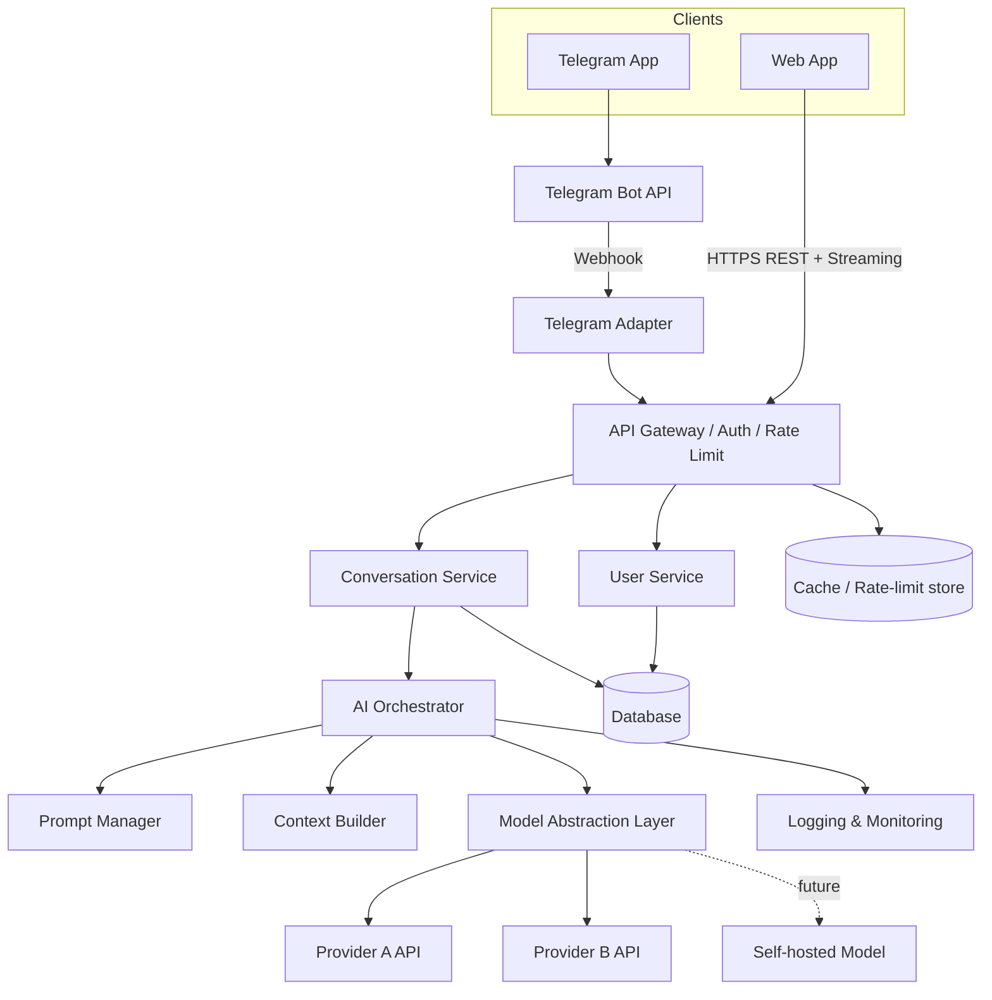
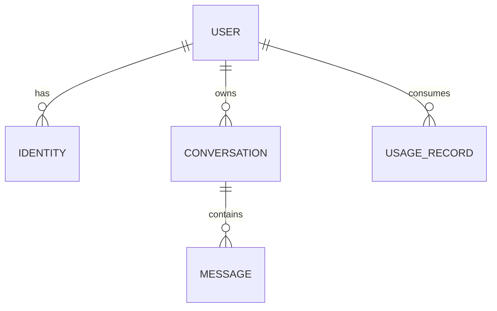
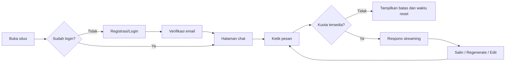

# Product Requirements Document (PRD)

## Multi-Platform General-Purpose AI Assistant

*Versi 0.1 (Draft untuk review stakeholder) • 7 November 2026*

**Legenda status informasi:** **\[FAKTA\]** = ditetapkan dalam spesifikasi proyek. **\[ASUMSI\]** = dugaan yang perlu dikonfirmasi. **\[REKOMENDASI\]** = saran tim penyusun. **TBD** = menunggu keputusan stakeholder.

---

# SECTION 1: PRODUCT FOUNDATION

## 1. Document Information

| Atribut | Nilai |
| --- | --- |
| Nama Produk (sementara) | Multi-Platform General-Purpose AI Assistant |
| Versi Dokumen | 0.1 (Draft) |
| Tanggal | 7 November 2026 |
| Status | Draft, menunggu review stakeholder |
| Pemilik Dokumen | TBD |
| Pembaca Utama | Product Manager, UI/UX Designer, Frontend Developer, Backend Developer, AI Engineer, QA Engineer |
| Bahasa Dokumen | Bahasa Indonesia |
| Dokumen Terkait | Belum ada (SRS, desain UI, dan API spec akan diturunkan dari PRD ini) |

## 2. Executive Summary

Produk ini adalah asisten AI serba guna yang dapat diakses lewat dua platform, yaitu **Web Application** dan **Telegram Bot**. Keduanya memakai satu backend, satu sistem pengguna, satu sistem manajemen percakapan, dan satu lapisan orkestrasi AI. Pengguna berinteraksi dengan bahasa natural untuk bertanya, menulis, meringkas, menerjemahkan, belajar, memprogram, dan menyelesaikan masalah sehari-hari.

Keputusan arsitektur utama **\[FAKTA\]**: MVP memakai AI Model API eksternal, dengan *abstraction layer* sehingga penyedia model dapat diganti tanpa mengubah business logic. Self-hosted model menjadi opsi pasca-MVP. Spesialisasi (Academic, Coding, Research, dan lainnya) berada di luar MVP, tetapi arsitektur disiapkan agar dapat ditambahkan lewat konfigurasi, prompt, tools, atau workflow.

PRD ini sengaja menjaga MVP tetap ramping: chat berstreaming, riwayat percakapan, autentikasi, Telegram bot dengan konteks multi-turn, serta fondasi keamanan, pembatasan penggunaan, dan observabilitas.

## 3. Product Overview

| Aspek | Deskripsi |
| --- | --- |
| Jenis produk | AI chat assistant serba guna (general-purpose) |
| Platform | Web (utama) dan Telegram Bot (alternatif) **\[FAKTA\]** |
| Pengalaman | Mengacu pada pola chatbot AI modern, tanpa menyalin identitas visual produk lain **\[FAKTA\]** |
| Backend | Satu backend bersama, platform-agnostic, API-first **\[FAKTA\]** |
| AI | Hybrid: API eksternal pada MVP, open-source/self-hosted pada tahap lanjut **\[FAKTA\]** |
| Pengguna awal | Masyarakat umum dewasa, tanpa pembatasan bidang **\[FAKTA\]** |

## 4. Background

**\[FAKTA\]** Asisten AI percakapan sudah menjadi pola interaksi yang dikenal luas. **\[FAKTA\]** Pemilik produk ingin membangun produk sendiri yang tersedia di web dan Telegram dengan fondasi yang dapat berkembang menjadi asisten terspesialisasi.

**\[ASUMSI\]** Telegram dipilih karena sudah banyak dipakai sehari-hari sehingga mengurangi hambatan akses (tanpa perlu membuka situs atau memasang aplikasi baru). Validasi jumlah pengguna Telegram pada pasar target belum dilakukan dan **tidak** diklaim dalam dokumen ini.

**\[ASUMSI\]** Produk berada pada tahap konsep. Belum ada data pengguna, data pasar, atau data biaya yang tersedia.

## 5. Problem Statement

1. Pengguna harus berpindah-pindah alat untuk kebutuhan berbeda (mencari informasi, menulis, menerjemahkan, membantu kode).
2. Pengguna sering membutuhkan bantuan cepat di aplikasi yang sudah mereka pakai setiap hari, bukan hanya di browser.
3. Percakapan yang terputus antar platform membuat pengguna kehilangan konteks.
4. Bagi pemilik produk, membangun logika AI terpisah per platform menyebabkan duplikasi, inkonsistensi perilaku, dan biaya pemeliharaan tinggi.
5. Ketergantungan pada satu penyedia model menciptakan risiko biaya, ketersediaan, dan kebijakan.

*Catatan:* poin 1 sampai 3 adalah hipotesis kebutuhan pengguna yang perlu divalidasi lewat riset pengguna (lihat Section 52).

## 6. Product Vision

Membangun AI Assistant yang mudah diakses, cerdas, fleksibel, dan dapat dipakai berbagai kalangan untuk membantu aktivitas sehari-hari melalui percakapan yang natural, di atas fondasi arsitektur yang dapat mengembangkan kemampuan baru tanpa membangun ulang sistem. **\[FAKTA\]**

## 7. Product Mission

- Menyediakan percakapan AI yang cepat, jelas, dan konsisten di web maupun Telegram.
- Menjaga privasi dan keamanan data percakapan pengguna.
- Menyediakan fondasi modular yang memungkinkan penambahan spesialisasi dan penggantian model AI.

## 8. Product Objectives

Target berikut adalah **\[REKOMENDASI\]** awal dan harus disetujui stakeholder (angka bukan data bisnis).

| ID | Objektif | Indikator Terukur (usulan) |
| --- | --- | --- |
| OBJ-01 | Pengalaman chat yang responsif | Waktu ke token pertama (TTFT) p95 ≤ 3 detik pada kondisi normal |
| OBJ-02 | Konsistensi lintas platform | 100% percakapan yang ditautkan dapat dibuka di Web dan Telegram dengan riwayat yang sama |
| OBJ-03 | Fleksibilitas model | Penggantian penyedia model cukup dengan perubahan konfigurasi, tanpa perubahan kode business logic |
| OBJ-04 | Keamanan dasar | Nol kebocoran API key ke klien; seluruh endpoint terproteksi autentikasi dan rate limiting |
| OBJ-05 | Siap diperluas | Modul spesialisasi baru dapat ditambahkan lewat konfigurasi/prompt tanpa mengubah inti orkestrasi |
| OBJ-06 | Keandalan | Ketersediaan layanan bulanan ≥ 99% pada MVP (target usulan, TBD) |

## 9. Product Value Proposition

| Untuk | Nilai |
| --- | --- |
| Pengguna umum | Satu asisten untuk berbagai kebutuhan, dapat diakses dari web atau dari Telegram yang sudah mereka pakai |
| Pemilik produk | Satu backend untuk dua platform, biaya pemeliharaan lebih rendah, bebas terkunci pada satu penyedia AI |
| Tim pengembang | Arsitektur modular dan API-first yang mudah diuji dan diperluas |

---

# SECTION 2: USER & BUSINESS ANALYSIS

## 10. Target Audience

**\[FAKTA\]** Pengguna awal adalah masyarakat umum dewasa tanpa batasan latar belakang. Produk tidak dikunci untuk satu bidang pada tahap awal.

| Segmen | Contoh kebutuhan utama |
| --- | --- |
| Pelajar dan mahasiswa | Penjelasan konsep, ringkasan materi, bantuan menulis |
| Pekerja profesional | Menyusun email, ringkasan, analisis informasi |
| Developer/programmer | Penjelasan kode, debugging, contoh implementasi |
| Pemilik usaha | Ide konten, deskripsi produk, balasan pelanggan |
| Content creator | Brainstorming ide, penulisan naskah |
| Peneliti | Merangkum dan menganalisis informasi yang diberikan pengguna |
| Pengguna umum | Tanya jawab, terjemahan, saran sehari-hari |

**\[REKOMENDASI\]** Pembatasan usia: pengguna dewasa (sesuai spesifikasi). Mekanisme verifikasi usia adalah TBD (lihat Section 51).

## 11. User Personas

Persona di bawah adalah **arketipe fiktif** untuk keperluan desain, bukan hasil riset pengguna.

| Persona | Profil | Tujuan | Kendala | Platform dominan |
| --- | --- | --- | --- | --- |
| Sari (Mahasiswa) | 21 tahun, kuliah, sering di ponsel | Memahami materi, merapikan tulisan | Waktu terbatas, butuh jawaban cepat | Telegram + Web |
| Budi (Karyawan) | 30 tahun, bekerja di kantor | Menyusun email dan ringkasan rapat | Tidak mau berpindah aplikasi | Web |
| Rangga (Developer) | 27 tahun, backend developer | Debugging dan penjelasan kode | Butuh render kode yang rapi | Web |
| Dewi (Pemilik usaha) | 35 tahun, jualan online | Menulis deskripsi produk dan balasan pelanggan | Waktu minim, tidak teknis | Telegram |

## 12. Stakeholder Analysis

| Stakeholder | Peran | Kepentingan | Pengaruh |
| --- | --- | --- | --- |
| Pemilik Produk | Penentu visi dan prioritas | Produk berhasil, biaya terkendali | Tinggi |
| Tim Pengembangan (FE, BE, AI) | Implementasi | Requirement jelas dan dapat diuji | Tinggi |
| UI/UX Designer | Desain pengalaman | Pola interaksi dan kebutuhan jelas | Sedang |
| QA Engineer | Pengujian | Acceptance criteria terukur | Sedang |
| Pengguna akhir | Pemakai produk | Respons berguna, aman, mudah | Tinggi (tidak langsung) |
| Penyedia AI Model | Pemasok kemampuan AI | Kepatuhan terhadap kebijakan penggunaan | Sedang |
| Telegram (platform) | Saluran distribusi | Kepatuhan terhadap ketentuan Bot API | Sedang |
| Pihak hukum/kepatuhan | Privasi dan regulasi | Kepatuhan perlindungan data pribadi | Sedang (TBD siapa yang bertanggung jawab) |

## 13. User Needs

| ID | Kebutuhan | Sumber |
| --- | --- | --- |
| UN-01 | Bertanya dan mendapat jawaban dengan bahasa natural | Hipotesis |
| UN-02 | Melanjutkan percakapan sebelumnya tanpa mengulang konteks | Hipotesis |
| UN-03 | Mengakses asisten dari perangkat dan aplikasi yang sudah dipakai | Hipotesis |
| UN-04 | Hasil mudah dibaca (format, kode) dan mudah disalin | Hipotesis |
| UN-05 | Mengontrol dan menghapus data percakapan sendiri | Hipotesis |
| UN-06 | Mendapat pesan yang jelas saat terjadi kesalahan atau batas penggunaan | Hipotesis |

## 14. User Pain Points

| ID | Pain Point | Dampak | Penanganan dalam produk |
| --- | --- | --- | --- |
| PP-01 | Jawaban muncul lambat tanpa indikator | Pengguna mengira sistem macet | Streaming dan indikator mengetik |
| PP-02 | Konteks hilang di tengah percakapan | Jawaban tidak relevan | Context management |
| PP-03 | Format jawaban/kode sulit dibaca atau disalin | Pekerjaan terhambat | Markdown, code block, tombol salin |
| PP-04 | Pesan error teknis yang membingungkan | Pengguna berhenti memakai | Pesan error ramah dan tindakan lanjutan |
| PP-05 | Kekhawatiran privasi | Enggan memakai | Kebijakan privasi, hapus data, isolasi data |
| PP-06 | Percakapan Telegram dan Web terpisah | Pengalaman terfragmentasi | Account linking |

## 15. User Journey

### 15.1 Journey Web (ringkas)

| Tahap | Aksi pengguna | Respons sistem | Titik risiko |
| --- | --- | --- | --- |
| Temuan | Membuka situs | Halaman landing dan ajakan masuk | Pengguna tidak paham manfaat |
| Registrasi/Login | Mendaftar dan masuk | Akun dibuat, sesi dimulai | Friksi pendaftaran |
| Percakapan pertama | Mengetik pertanyaan | Jawaban streaming | Respons lambat |
| Lanjutan | Membuka riwayat, percakapan baru | Riwayat tersimpan dan dapat dicari | Riwayat tidak ditemukan |
| Pengelolaan | Mengubah tema, menghapus data | Pengaturan tersimpan | Data tidak benar-benar terhapus |

### 15.2 Journey Telegram (ringkas)

| Tahap | Aksi pengguna | Respons sistem | Titik risiko |
| --- | --- | --- | --- |
| Temuan | Membuka bot, menekan Start | Sambutan dan panduan singkat | Pengguna tidak tahu cara memakai |
| Percakapan | Mengirim pesan | Jawaban (dikirim bertahap/utuh) | Batas panjang pesan Telegram |
| Kontrol | /new, /help, /link | Percakapan baru atau tautan akun | Perintah tidak dikenali |
| Batas penggunaan | Melewati kuota | Pesan batas dan waktu reset | Pengguna frustrasi |

## 16. Business Goals

**Model bisnis belum ditetapkan (TBD).** Opsi yang perlu diputuskan: gratis penuh, freemium dengan batas penggunaan, berlangganan, atau internal. Tujuan bisnis berikut bersifat **\[REKOMENDASI\]**.

| ID | Tujuan bisnis | Keterangan |
| --- | --- | --- |
| BG-01 | Memvalidasi kebutuhan pasar dengan MVP | Rilis terbatas lalu kumpulkan umpan balik |
| BG-02 | Mengendalikan biaya inferensi AI | Rate limit, kuota, dan pemantauan token |
| BG-03 | Membangun fondasi lintas spesialisasi | Arsitektur modular |
| BG-04 | Membangun kepercayaan pengguna | Privasi dan keamanan sejak awal |

## 17. Success Metrics (KPIs)

Tidak ada data dasar (baseline). Semua target adalah **usulan awal** yang harus dikalibrasi setelah periode pilot.

| ID | Metrik | Definisi | Target awal (usulan) |
| --- | --- | --- | --- |
| KPI-01 | Activation rate | % pengguna baru yang mengirim ≥ 1 pesan dalam 24 jam setelah daftar | TBD setelah baseline |
| KPI-02 | Retensi D7 | % pengguna aktif kembali pada hari ke-7 | TBD setelah baseline |
| KPI-03 | TTFT p95 | Waktu ke token pertama | ≤ 3 detik |
| KPI-04 | Error rate respons AI | % permintaan gagal | < 2% |
| KPI-05 | Biaya token per pengguna aktif | Total biaya model / pengguna aktif | TBD (tergantung model dan harga) |
| KPI-06 | Kepuasan | Rasio umpan balik positif vs total (jika fitur umpan balik ada) | TBD |
| KPI-07 | Adopsi Telegram | % pengguna aktif yang memakai Telegram | Dipantau, tanpa target |
| KPI-08 | Insiden keamanan | Jumlah insiden kebocoran data/kunci | 0 |

---

# SECTION 3: PRODUCT REQUIREMENTS

## 18. Product Scope

### 18.1 Dalam Lingkup MVP

- Web app: autentikasi, chat berstreaming, riwayat, percakapan baru, rendering Markdown dan kode, salin, regenerate, pengaturan dasar, tema gelap/terang, responsif.
- Telegram bot: percakapan multi-turn, perintah dasar, identifikasi pengguna, pembatasan penggunaan, account linking.
- Backend bersama: manajemen pengguna, percakapan, orkestrasi AI, abstraction layer model, rate limiting, logging.
- Kemampuan AI MVP: percakapan umum, tanya jawab, generasi teks, ringkasan (teks yang diberikan pengguna), terjemahan, penjelasan/belajar, bantuan pemrograman, brainstorming, bantuan menulis, pemecahan masalah.

### 18.2 Di Luar Lingkup MVP

Pencarian internet real-time, analisis dokumen/file, vision (gambar), voice, tools/agent, spesialisasi domain, self-hosted model, aplikasi mobile native, pembayaran. Rincian ada di Section 53.

**Pernyataan kemampuan:** asisten **tidak boleh** mengklaim memiliki akses internet real-time, membaca dokumen, melihat gambar, atau mendengar suara selama integrasi teknisnya belum ada. Instruksi ini dimasukkan ke system prompt (lihat Section 30).

## 19. Platform Requirements

| Platform | Kebutuhan | Prioritas |
| --- | --- | --- |
| Web | Browser modern versi terbaru (Chrome, Edge, Firefox, Safari); responsif untuk ponsel, tablet, desktop; tema gelap/terang | Utama |
| Telegram | Telegram Bot API; mode update webhook (rekomendasi) atau long polling untuk pengembangan; mendukung chat pribadi (private chat); grup **tidak** dalam MVP | Alternatif |
| Backend | Satu layanan API bersama untuk kedua platform | Wajib |
| Konsistensi | Perilaku AI, aturan konteks, dan batas penggunaan identik di kedua platform | Wajib |

## 20. Functional Requirements

Semua FR berlaku untuk MVP kecuali disebutkan lain. Peran: **Tamu** (belum masuk), **Pengguna** (terautentikasi), **Admin** (operasional). Prioritas memakai MoSCoW.

### 20.1 Autentikasi dan Akun

| Atribut | FR-001 Registrasi | FR-002 Login/Logout | FR-003 Profil dan Pengaturan |
| --- | --- | --- | --- |
| Deskripsi | Pengguna membuat akun baru | Pengguna masuk dan keluar dengan aman | Pengguna mengubah nama tampilan, tema, bahasa antarmuka |
| Peran | Tamu | Tamu/Pengguna | Pengguna |
| Prasyarat | Belum memiliki akun; metode registrasi disetujui (email+kata sandi, OAuth, atau keduanya: TBD) | Akun sudah ada dan aktif | Sudah login |
| Alur Utama | 1. Isi formulir. 2. Sistem memvalidasi. 3. Akun dibuat. 4. Verifikasi email dikirim. 5. Pengguna memverifikasi. | 1. Isi kredensial. 2. Sistem memverifikasi. 3. Sesi dibuat. 4. Logout menghapus sesi. | 1. Buka Pengaturan. 2. Ubah nilai. 3. Simpan. |
| Alur Alternatif | Email sudah terdaftar: tampilkan pesan netral. Kata sandi lemah: tampilkan aturan. | Kredensial salah: pesan generik. 5 kegagalan beruntun: kunci sementara. | Validasi gagal: tampilkan kesalahan per field. |
| Hasil | Akun aktif dan terverifikasi | Sesi aktif/berakhir | Pengaturan tersimpan dan berlaku di sesi berikutnya |
| Prioritas | Must | Must | Should |
| Acceptance Criteria | Akun tidak dapat dipakai sebelum email terverifikasi; kata sandi ≥ 8 karakter dan tersimpan sebagai hash (bukan plaintext) | Sesi kedaluwarsa sesuai kebijakan; setelah logout, akses ke endpoint terproteksi mengembalikan 401 | Perubahan tema berlaku ≤ 1 detik tanpa muat ulang halaman |

### 20.2 Chat Web

| ID | Nama | Deskripsi | Peran | Prasyarat | Alur Utama | Alur Alternatif | Hasil | Prioritas | Acceptance Criteria |
| --- | --- | --- | --- | --- | --- | --- | --- | --- | --- |
| FR-004 | Kirim Pesan dan Terima Respons Streaming | Pengguna mengirim prompt dan menerima respons bertahap | Pengguna | Login; percakapan aktif atau baru | 1. Ketik pesan. 2. Kirim. 3. Backend memanggil model. 4. Token ditampilkan bertahap. | Model gagal: tampilkan error dan tombol Coba lagi. Koneksi putus: pertahankan teks parsial dan tawarkan lanjut. Pesan kosong: tombol Kirim nonaktif. | Respons lengkap tersimpan di riwayat | Must | Token pertama tampil ≤ 3 detik (p95, kondisi normal); pesan tersimpan setelah selesai; batas panjang input tervalidasi |
| FR-005 | Percakapan Baru | Memulai sesi percakapan baru dengan konteks kosong | Pengguna | Login | 1. Klik Chat Baru. 2. Area chat dikosongkan. 3. Percakapan dibuat saat pesan pertama dikirim. | Percakapan kosong tidak disimpan. | Percakapan baru muncul di sidebar | Must | Konteks percakapan lama tidak terbawa ke yang baru |
| FR-006 | Riwayat dan Multi-Sesi | Daftar percakapan di sidebar, urut terbaru | Pengguna | Memiliki ≥ 1 percakapan | 1. Buka sidebar. 2. Pilih percakapan. 3. Pesan dimuat. | Daftar kosong: tampilkan keadaan kosong. | Riwayat dimuat dengan urutan benar | Must | Hanya percakapan milik pengguna yang tampil; muat ≤ 2 detik untuk 100 percakapan |
| FR-007 | Judul Percakapan Otomatis dan Ubah Nama | Judul dibuat dari pesan pertama; dapat diubah manual | Pengguna | Percakapan ada | 1. Sistem membuat judul. 2. Pengguna dapat mengganti. | Pembuatan judul gagal: gunakan potongan pesan pertama. | Judul tersimpan | Should | Judul ≤ 80 karakter |
| FR-008 | Pencarian Percakapan | Mencari teks pada judul dan isi pesan milik sendiri | Pengguna | Memiliki riwayat | 1. Ketik kata kunci. 2. Hasil ditampilkan. | Tidak ada hasil: pesan kosong. | Daftar hasil relevan | Should | Hasil tidak pernah memuat data pengguna lain; hasil tampil ≤ 2 detik |
| FR-009 | Hapus Percakapan | Menghapus satu percakapan | Pengguna | Percakapan ada | 1. Pilih Hapus. 2. Konfirmasi. 3. Data dihapus. | Batal: tidak ada perubahan. | Percakapan hilang dari UI dan penyimpanan aktif | Must | Setelah dihapus, API mengembalikan 404 untuk percakapan tersebut |
| FR-010 | Rendering Markdown dan Kode | Menampilkan format teks, daftar, tabel, dan blok kode berwarna | Pengguna | Respons tersedia | Respons dirender otomatis | Markdown tidak valid: tampil sebagai teks biasa. | Tampilan terbaca | Must | Konten HTML mentah dari model disanitasi (tidak dapat menjalankan skrip) |
| FR-011 | Salin Respons | Tombol salin pada respons dan blok kode | Pengguna | Respons tersedia | Klik Salin, teks masuk clipboard | Izin clipboard ditolak: tampilkan pesan. | Teks tersalin | Must | Konfirmasi visual muncul ≤ 1 detik |
| FR-012 | Regenerate Respons | Menghasilkan ulang jawaban terakhir | Pengguna | Ada respons AI terakhir | 1. Klik Regenerate. 2. Respons baru menggantikan atau ditambahkan sebagai versi. | Gagal: pertahankan respons lama. | Respons baru tersedia | Should | Konteks yang dipakai identik dengan permintaan semula |
| FR-013 | Edit dan Kirim Ulang Prompt | Mengubah pesan pengguna lalu mengirim ulang | Pengguna | Ada pesan pengguna | 1. Klik Edit. 2. Ubah. 3. Kirim; respons berikutnya dibuat ulang. | Batal edit: tidak ada perubahan. | Cabang percakapan dari titik edit | Should | Pesan setelah titik edit tidak dipakai sebagai konteks (perilaku cabang/penggantian ditetapkan desainer: TBD) |
| FR-014 | Hentikan Generasi | Menghentikan respons yang sedang berjalan | Pengguna | Respons sedang streaming | Klik Stop | Sudah selesai: tombol hilang. | Streaming berhenti; teks parsial tersimpan | Should | Pemanggilan model dihentikan ≤ 2 detik setelah klik (agar token tidak terus dihitung) |
| FR-015 | Tema Gelap/Terang dan Responsif | Tema dan tata letak adaptif | Pengguna | Tidak ada | Pilih tema atau ikuti pengaturan sistem | Tidak ada | UI konsisten | Must | Tata letak dapat dipakai pada lebar 360 px ke atas |

### 20.3 Telegram Bot

| ID | Nama | Deskripsi | Peran | Prasyarat | Alur Utama | Alur Alternatif | Hasil | Prioritas | Acceptance Criteria |
| --- | --- | --- | --- | --- | --- | --- | --- | --- | --- |
| FR-016 | Mulai dan Identifikasi Pengguna | /start membuat profil berdasarkan Telegram ID | Pengguna | Bot aktif | 1. Tekan Start. 2. Bot menerima update. 3. Sistem membuat/mengambil profil. 4. Bot mengirim sambutan. | Pengguna memblokir bot: hentikan pengiriman. | Profil Telegram terhubung | Must | Update diverifikasi berasal dari Telegram (secret token webhook); satu Telegram ID memetakan satu profil |
| FR-017 | Percakapan Multi-Turn | Pesan teks dijawab dengan konteks sebelumnya | Pengguna | Profil ada | 1. Kirim pesan. 2. Sistem memuat konteks. 3. Panggil orkestrasi AI. 4. Kirim jawaban. | Gagal: kirim pesan error ramah. | Jawaban terkirim dan tersimpan | Must | Konteks dan aturan identik dengan Web; jawaban panjang dipecah sesuai batas pesan Telegram |
| FR-018 | Perintah Dasar | /start, /help, /new, /reset, /link, /usage | Pengguna | Profil ada | Bot mengeksekusi perintah | Perintah tidak dikenal: tampilkan daftar bantuan. | Aksi perintah berjalan | Must | Setiap perintah merespons ≤ 2 detik (selain pemanggilan AI) |
| FR-019 | Indikator Memproses | Bot menampilkan status mengetik selama menunggu | Pengguna | Pesan diterima | Kirim aksi typing sampai jawaban siap | Tidak ada | Pengguna tahu bot bekerja | Should | Indikator muncul ≤ 1 detik setelah pesan diterima |
| FR-020 | Account Linking Web-Telegram | Menautkan akun Telegram ke akun Web | Pengguna | Login di Web; sudah memakai bot | 1. Web membuat kode sekali pakai. 2. Pengguna mengirim /link KODE. 3. Sistem menautkan. | Kode kedaluwarsa atau salah: tolak dan beri petunjuk. | Riwayat terpadu | Should | Kode berlaku ≤ 10 menit, sekali pakai; setelah tertaut, percakapan tampil di kedua platform |
| FR-021 | Penanganan Pesan Non-Teks | Menanggapi foto, suara, file | Pengguna | Profil ada | Bot membalas bahwa jenis pesan belum didukung | Tidak ada | Pengguna paham batasan | Must | Bot tidak mengklaim telah menganalisis konten non-teks |

### 20.4 Lintas Platform, Batas Penggunaan, dan Administrasi

| ID | Nama | Deskripsi | Peran | Prasyarat | Alur Utama | Alur Alternatif | Hasil | Prioritas | Acceptance Criteria |
| --- | --- | --- | --- | --- | --- | --- | --- | --- | --- |
| FR-022 | Pembatasan Penggunaan (Rate Limit dan Kuota) | Membatasi jumlah pesan/token per pengguna | Pengguna | Sistem aktif | 1. Sistem menghitung penggunaan. 2. Melebihi batas: tolak. 3. Tampilkan waktu reset. | Admin menaikkan batas per pengguna (Could). | Penggunaan terkendali | Must | Batas diterapkan di Web dan Telegram secara terpadu; nilai batas dapat dikonfigurasi tanpa deploy ulang |
| FR-023 | Penanganan Kesalahan AI | Pesan error yang jelas saat model gagal, timeout, atau terblokir | Pengguna | Permintaan dikirim | Sistem mencoba ulang terbatas atau fallback model, lalu menampilkan pesan | Semua gagal: pesan ramah dan opsi coba lagi | Pengguna tidak melihat error teknis mentah | Must | Timeout permintaan terkonfigurasi (usulan 60 detik); maksimum 2 retry |
| FR-024 | Hapus Data Akun | Pengguna dapat meminta penghapusan semua data | Pengguna | Login | 1. Pilih Hapus akun. 2. Konfirmasi ulang. 3. Data dihapus/dianonimkan sesuai kebijakan retensi. | Batal | Data terhapus | Must | Penghapusan selesai dalam jangka waktu kebijakan (TBD, usulan ≤ 30 hari) dan pengguna menerima konfirmasi |
| FR-025 | Konfigurasi Model dan Prompt Sistem | Admin mengatur model aktif dan system prompt tanpa mengubah kode | Admin | Login admin | Ubah konfigurasi, tersimpan dengan versi | Konfigurasi tidak valid ditolak | Perilaku AI berubah sesuai konfigurasi | Should | Perubahan tercatat dalam audit log |
| FR-026 | Panel Admin Dasar | Melihat penggunaan dan menonaktifkan akun abusif | Admin | Login admin | Lihat metrik, kelola status akun | Tidak ada | Operasional terkendali | Could (MVP minimum: cukup lewat dashboard/DB; panel UI Post-MVP) | Admin tidak dapat membaca isi percakapan tanpa kebijakan akses yang disetujui |

## 21. Non-Functional Requirements

Nilai angka berikut adalah **usulan** dan harus divalidasi.

| ID | Kategori | Requirement | Cara Uji |
| --- | --- | --- | --- |
| NFR-001 | Performa | TTFT p95 ≤ 3 detik; pemuatan awal halaman Web ≤ 3 detik pada koneksi 4G | Load/performance test |
| NFR-002 | Skalabilitas | Backend stateless dan dapat diskalakan horizontal; target awal 100 pengguna bersamaan (TBD) | Load test |
| NFR-003 | Ketersediaan | ≥ 99% per bulan (di luar pemeliharaan terjadwal) | Monitoring uptime |
| NFR-004 | Keamanan | Seluruh lalu lintas memakai HTTPS/TLS; API key penyedia AI hanya di server | Security review, pentest dasar |
| NFR-005 | Privasi | Data pengguna terisolasi: tidak ada akses silang antar pengguna | Uji otorisasi otomatis |
| NFR-006 | Keandalan | Tidak ada kehilangan pesan terkirim; operasi tulis idempoten untuk update Telegram duplikat | Uji integrasi |
| NFR-007 | Kompatibilitas | Mendukung dua versi mayor terbaru Chrome, Edge, Firefox, Safari | Uji lintas browser |
| NFR-008 | Aksesibilitas | Mengacu pada WCAG 2.1 AA untuk komponen inti (kontras, navigasi keyboard) | Audit aksesibilitas |
| NFR-009 | Maintainability | Cakupan uji otomatis untuk business logic inti ≥ 70% (usulan) | Laporan coverage |
| NFR-010 | Observabilitas | Setiap permintaan memiliki ID korelasi; metrik latensi, error, dan token dikumpulkan | Verifikasi log/metrik |
| NFR-011 | Portabilitas AI | Penggantian penyedia model hanya melalui konfigurasi dan adapter | Uji penggantian provider |
| NFR-012 | Lokalisasi | Antarmuka dan respons AI mendukung Bahasa Indonesia dan Inggris (bahasa tambahan: TBD) | Uji fungsional |

## 22. User Stories

| ID | Sebagai | Saya ingin | Agar | FR Terkait |
| --- | --- | --- | --- | --- |
| US-01 | Pengguna baru | mendaftar dan masuk dengan mudah | dapat mulai memakai asisten | FR-001, FR-002 |
| US-02 | Pengguna | melihat jawaban muncul bertahap | tidak menunggu lama tanpa kepastian | FR-004 |
| US-03 | Pengguna | melihat dan mencari riwayat percakapan | dapat melanjutkan pekerjaan sebelumnya | FR-006, FR-008 |
| US-04 | Developer | kode tampil dalam blok yang dapat disalin | dapat langsung memakainya | FR-010, FR-011 |
| US-05 | Pengguna | menghasilkan ulang atau mengubah prompt | mendapat jawaban yang lebih sesuai | FR-012, FR-013 |
| US-06 | Pengguna Telegram | bertanya langsung di Telegram | tidak perlu membuka aplikasi lain | FR-016, FR-017 |
| US-07 | Pengguna | menautkan Telegram dengan akun Web | riwayat saya konsisten | FR-020 |
| US-08 | Pengguna | menghapus percakapan dan akun saya | data saya terkendali | FR-009, FR-024 |
| US-09 | Pemilik produk | membatasi penggunaan per pengguna | biaya terkendali | FR-022 |
| US-10 | Admin | mengganti model tanpa deploy ulang | cepat beradaptasi terhadap biaya/kualitas | FR-025 |

## 23. Use Cases

| ID | Nama | Aktor | Ringkasan | Hasil |
| --- | --- | --- | --- | --- |
| UC-01 | Mengirim pertanyaan di Web | Pengguna | Mengirim prompt dan menerima respons streaming | Respons tersimpan di riwayat |
| UC-02 | Melanjutkan percakapan lama | Pengguna | Memilih percakapan dari sidebar dan melanjutkan | Konteks lama dipakai |
| UC-03 | Bertanya melalui Telegram | Pengguna | Mengirim pesan ke bot dan menerima jawaban | Jawaban terkirim, konteks tersimpan |
| UC-04 | Menautkan akun | Pengguna | Membuat kode di Web dan mengirim /link di Telegram | Riwayat terpadu |
| UC-05 | Melewati batas penggunaan | Pengguna | Mengirim pesan setelah kuota habis | Pesan batas dan waktu reset |
| UC-06 | Kegagalan penyedia AI | Sistem | Penyedia utama gagal, sistem mencoba fallback/mengirim error | Pengguna mendapat respons atau pesan jelas |

## 24. Feature Specifications

### 24.1 Layout Web (acuan desain, bukan desain final)

| Area | Isi | Perilaku |
| --- | --- | --- |
| Sidebar kiri | Tombol Chat Baru, kolom pencarian, daftar percakapan | Dapat dilipat; pada layar kecil menjadi drawer |
| Area chat utama | Daftar pesan, tombol salin/regenerate/edit | Auto-scroll ke bawah saat streaming; berhenti jika pengguna menggulir ke atas |
| Composer | Kolom teks multi-baris, tombol Kirim/Stop | Enter mengirim, Shift+Enter baris baru; batas karakter ditampilkan |
| Menu pengguna | Profil, Pengaturan, Keluar | Muncul dari pojok kiri bawah |
| Pengaturan | Tema, bahasa, hapus data, tautan Telegram | Perubahan tersimpan per akun |

Identitas visual (logo, warna, tipografi) harus orisinal dan **tidak menyalin** produk lain.

### 24.2 Perilaku Telegram

| Aspek | Spesifikasi |
| --- | --- |
| Format jawaban | Mengacu pada format yang didukung Bot API (MarkdownV2/HTML); jika gagal parse, kirim sebagai teks biasa |
| Pesan panjang | Dipecah di batas paragraf sesuai batas panjang pesan Telegram |
| Streaming | MVP mengirim jawaban utuh setelah selesai (indikator mengetik selama menunggu); streaming via edit pesan adalah Post-MVP |
| Konteks | Memakai satu percakapan aktif per pengguna sampai /new dipanggil |
| Grup | Tidak didukung pada MVP |

## 25. Business Rules

| ID | Aturan |
| --- | --- |
| BR-001 | Setiap percakapan dimiliki tepat satu pengguna dan tidak dapat diakses pengguna lain. |
| BR-002 | Aturan konteks, system prompt, dan batas penggunaan identik di Web dan Telegram. |
| BR-003 | Pengguna harus berusia dewasa sesuai hukum yang berlaku; mekanisme persetujuan dan verifikasi: TBD. |
| BR-004 | Penggunaan dibatasi per pengguna (bukan per platform) setelah akun ditautkan. |
| BR-005 | Asisten tidak boleh mengklaim kemampuan yang belum terintegrasi (internet real-time, analisis dokumen, vision, voice). |
| BR-006 | Pengguna dapat menghapus data percakapan miliknya; penghapusan bersifat permanen setelah masa retensi. |
| BR-007 | Akun yang melanggar kebijakan penggunaan dapat dibatasi atau dinonaktifkan. |
| BR-008 | Kunci API penyedia AI tidak pernah dikirim ke klien. |

## 26. Acceptance Criteria (Tingkat Produk MVP)

MVP diterima jika seluruh item berikut terpenuhi:

1. Seluruh FR berprioritas **Must** lulus uji penerimaan.
2. NFR-001, NFR-004, NFR-005, dan NFR-006 lulus uji.
3. Percakapan yang sama dapat dilanjutkan dari Web dan Telegram setelah account linking.
4. Penggantian penyedia model dibuktikan dengan setidaknya dua adapter (satu utama dan satu cadangan/pengujian) tanpa perubahan business logic.
5. Tidak ada temuan keamanan berkeparahan Tinggi/Kritis yang belum ditutup.
6. Dokumentasi API dan runbook operasional tersedia.

---

# SECTION 4: AI REQUIREMENTS

## 27. AI Capabilities

Semua kemampuan di bawah adalah hasil dari model bahasa (LLM) yang menerima teks dari pengguna. Pada MVP asisten bekerja **hanya dari pengetahuan model dan teks yang dikirim pengguna**.

| No | Kemampuan | Tahap | Catatan |
| --- | --- | --- | --- |
| 1 | General Conversation | MVP (Must) | Dasar produk |
| 2 | Question Answering | MVP (Must) | Berdasarkan pengetahuan model; dapat keliru dan tidak real-time |
| 3 | Text Generation | MVP (Must) | Email, artikel, naskah |
| 4 | Text Summarization | MVP (Should) | Teks yang ditempel pengguna; belum untuk file/URL |
| 5 | Translation | MVP (Should) | Pasangan bahasa mengikuti kemampuan model |
| 6 | Explanation and Learning Assistance | MVP (Must) | Penjelasan bertahap |
| 7 | Programming Assistance | MVP (Must) | Penjelasan, debugging, contoh kode; kode tidak dieksekusi |
| 8 | Brainstorming | MVP (Should) |  |
| 9 | Logical Reasoning | MVP (Should) | Kualitas bergantung model |
| 10 | Information Analysis | MVP (Could) | Terbatas pada informasi yang diberikan pengguna |
| 11 | Writing Assistance | MVP (Should) | Penyuntingan, penyederhanaan |
| 12 | Problem Solving | MVP (Should) |  |
| — | Internet search, analisis dokumen, vision, voice | Post-MVP | Butuh integrasi teknis tersendiri; tidak boleh diklaim pada MVP |

## 28. AI Model Integration

| Aspek | Requirement |
| --- | --- |
| Pendekatan MVP | Integrasi AI Model API eksternal **\[FAKTA\]**; penyedia dan model spesifik: **TBD** (kriteria pemilihan di bawah) |
| Abstraction layer | Antarmuka internal seragam (`generate`, `stream`, `count_tokens`) dengan satu adapter per penyedia |
| Multi-provider | Minimal dua adapter siap dipakai pada akhir MVP agar penggantian dapat dibuktikan |
| Model switching | Dikonfigurasi per lingkungan/pengguna/spesialisasi lewat konfigurasi, bukan kode |
| Fallback | Jika penyedia utama gagal/timeout, coba penyedia cadangan (maks 2 percobaan) |
| Pengembangan lanjut | Adapter untuk model open-source/self-hosted (misalnya endpoint bergaya OpenAI-compatible) tanpa mengubah orkestrasi |

**Kriteria pemilihan penyedia \[REKOMENDASI\]:** kualitas Bahasa Indonesia, harga per token, latensi, dukungan streaming, batas konteks, kebijakan retensi data penyedia, dan syarat penggunaan.

## 29. AI Orchestration

Orkestrator adalah satu-satunya komponen yang memanggil model. Web dan Telegram hanya memanggil layanan percakapan.

**Alur permintaan:**

1. Validasi dan sanitasi input; cek otorisasi dan kuota.
2. Muat percakapan dan bangun konteks (system prompt + riwayat terpilih + pesan baru).
3. Pilih model/penyedia berdasarkan konfigurasi.
4. Panggil adapter (streaming).
5. Terapkan pasca-pemrosesan dan pemeriksaan keamanan.
6. Simpan pesan, hitung token, kirim ke klien.

| ID | Requirement |
| --- | --- |
| AI-001 | Tidak ada logika AI di klien Web maupun handler Telegram; keduanya memanggil Conversation Service. |
| AI-002 | Orkestrator mencatat penyedia, model, versi prompt, jumlah token, dan latensi untuk setiap permintaan. |
| AI-003 | Orkestrator mendukung mode streaming dan non-streaming dari adapter yang sama. |
| AI-004 | Titik ekstensi untuk tools/workflow disediakan (interface kosong) tetapi **tidak diaktifkan** pada MVP. |

## 30. Prompt Management

| ID | Requirement |
| --- | --- |
| PM-001 | System prompt disimpan terpisah dari kode, memiliki versi, dan dapat diubah tanpa deploy ulang (FR-025). |
| PM-002 | System prompt menetapkan: peran asisten, gaya bahasa (mengikuti bahasa pengguna), batasan kemampuan (tidak ada internet/file/vision/voice), dan sikap jujur saat tidak yakin. |
| PM-003 | Struktur prompt memisahkan instruksi sistem dari input pengguna agar instruksi tidak tercampur. |
| PM-004 | Template prompt per spesialisasi dapat ditambahkan di masa depan melalui konfigurasi (profil asisten). |
| PM-005 | Setiap perubahan prompt tercatat (siapa, kapan, versi) dan dapat dikembalikan ke versi sebelumnya. |

## 31. Context Management

| Aspek | Requirement |
| --- | --- |
| Jendela konteks | Konteks dibangun dalam batas token model yang dipakai; batas dibaca dari konfigurasi model |
| Strategi MVP | Sliding window: system prompt + N pesan terbaru yang muat dalam anggaran token (misalnya cadangan 20% untuk jawaban) |
| Pemangkasan | Pesan terlama dibuang lebih dulu; system prompt tidak pernah dibuang |
| Ringkasan konteks | Peringkasan otomatis untuk percakapan panjang: Post-MVP (**\[REKOMENDASI\]**) |
| Isolasi | Konteks hanya dibangun dari percakapan milik pengguna yang sama |
| Telegram | Satu percakapan aktif; /new memulai konteks baru |

## 32. Conversation Memory

| Level | Deskripsi | Tahap |
| --- | --- | --- |
| Memori jangka pendek | Riwayat dalam satu percakapan (konteks di atas) | MVP |
| Memori lintas percakapan | Preferensi/fakta tentang pengguna yang diingat antar percakapan | Post-MVP; wajib opt-in, dapat dilihat dan dihapus pengguna |
| Memori terstruktur/RAG | Pengetahuan dari dokumen pengguna | Long-term |

Keputusan produk: memori lintas percakapan **tidak** masuk MVP karena menambah kompleksitas privasi dan biaya.

## 33. AI Response Handling

| ID | Requirement |
| --- | --- |
| RH-001 | Respons di-stream ke Web per potongan (misalnya Server-Sent Events atau WebSocket; pilihan teknis oleh tim arsitektur). |
| RH-002 | Seluruh keluaran model diperlakukan sebagai tidak tepercaya: di-escape/disanitasi sebelum dirender (mencegah XSS). |
| RH-003 | Respons parsial yang terputus disimpan dengan penanda status `incomplete`. |
| RH-004 | Respons yang diblokir oleh kebijakan penyedia ditampilkan sebagai pesan penolakan yang sopan, bukan error teknis. |
| RH-005 | Pengguna dapat memberi umpan balik jempol atas/bawah pada respons (Could, MVP; KPI-06). |
| RH-006 | Disclaimer singkat bahwa jawaban AI dapat keliru ditampilkan di UI (teks final: TBD). |

## 34. AI Error Handling

| Kondisi | Penanganan | Pesan ke pengguna |
| --- | --- | --- |
| Timeout | Retry maks 2x, lalu fallback provider | "Layanan sedang lambat, coba lagi sebentar." |
| Rate limit penyedia (429) | Backoff eksponensial, antrean singkat | Sama |
| Penyedia tidak tersedia | Fallback provider | Jika semua gagal: "Layanan sedang tidak tersedia." |
| Input melebihi batas konteks | Pangkas konteks; jika pesan tunggal terlalu panjang, tolak | "Pesan terlalu panjang. Singkatkan atau bagi menjadi beberapa bagian." |
| Respons kosong/tidak valid | Retry sekali | Pesan error ramah |
| Kuota pengguna habis | Tolak sebelum memanggil model | Tampilkan waktu reset |

Semua kegagalan dicatat dengan ID korelasi tanpa menyimpan isi percakapan di log aplikasi.

## 35. Token and Usage Management

| ID | Requirement |
| --- | --- |
| TK-001 | Sistem mencatat token input/output per permintaan, per pengguna, per percakapan. |
| TK-002 | Kuota harian dan/atau bulanan per pengguna dikonfigurasi (nilai awal: TBD, sebaiknya diputuskan setelah estimasi biaya). |
| TK-003 | Batas panjang input per pesan dan `max_tokens` output ditetapkan lewat konfigurasi. |
| TK-004 | Pengguna dapat melihat sisa kuota (/usage di Telegram; halaman Pengaturan di Web). |
| TK-005 | Peringatan biaya otomatis ke admin saat pemakaian harian melewati ambang (usulan 80% anggaran harian: TBD). |
| TK-006 | Penghitungan token memakai tokenizer penyedia; jika tidak tersedia, pakai estimasi konservatif. |

---

# SECTION 5: SYSTEM REQUIREMENTS

## 36. System Architecture

Arsitektur tingkat tinggi **\[REKOMENDASI\]**. Pemilihan teknologi spesifik (bahasa, framework, database, cloud) adalah TBD dan ditetapkan oleh tim arsitektur.

| Komponen | Tanggung jawab |
| --- | --- |
| API Gateway | Autentikasi, otorisasi, rate limiting, validasi input |
| Telegram Adapter | Menerima webhook, verifikasi, memetakan update menjadi permintaan ke Conversation Service, memformat balasan |
| User Service | Akun, profil, penautan identitas (Web/Telegram) |
| Conversation Service | Percakapan, pesan, riwayat, pencarian |
| AI Orchestrator | Alur permintaan AI (Section 29) |
| Model Abstraction Layer | Adapter per penyedia, fallback |
| Database | Penyimpanan persisten |
| Cache/Rate-limit store | Penghitung kuota dan data sementara |
| Logging & Monitoring | Log, metrik, alert |

**Keputusan desain penting:** Telegram Adapter hanyalah lapisan tipis; seluruh logika percakapan dan AI berada di backend bersama. Alasannya: mencegah duplikasi dan menjamin konsistensi perilaku (OBJ-02).

## 37. Web Application Requirements

| ID | Requirement |
| --- | --- |
| WEB-001 | Single-page application responsif dengan layout sidebar, area chat, composer, menu pengguna (Section 24.1). |
| WEB-002 | Menerima streaming dari backend dan merender bertahap tanpa memblokir UI. |
| WEB-003 | Seluruh konten dari model dirender melalui renderer Markdown yang disanitasi. |
| WEB-004 | Token sesi disimpan dengan cara aman (misalnya cookie HttpOnly + SameSite); tidak di localStorage untuk token sensitif. |
| WEB-005 | Status loading, kosong, error, dan offline ditangani pada setiap layar. |
| WEB-006 | Mendukung tema gelap/terang dan preferensi sistem. |

## 38. Telegram Bot Requirements

| ID | Requirement |
| --- | --- |
| TGB-001 | Menggunakan Telegram Bot API; webhook dengan secret token untuk produksi. |
| TGB-002 | Token bot disimpan sebagai secret di server, tidak di repositori kode. |
| TGB-003 | Pemrosesan update idempoten (mengabaikan `update_id` duplikat). |
| TGB-004 | Menangani batas laju Telegram (HTTP 429) dengan retry sesuai `retry_after`. |
| TGB-005 | Hanya chat pribadi (private) pada MVP; pesan dari grup diabaikan atau dibalas petunjuk singkat. |
| TGB-006 | Daftar perintah didaftarkan ke Telegram agar muncul di menu perintah. |

## 39. Backend Requirements

| ID | Requirement |
| --- | --- |
| BE-001 | Backend stateless; status sesi/percakapan di database/cache. |
| BE-002 | Modul terpisah: Auth, User, Conversation, Orchestrator, Telegram Adapter, Admin. |
| BE-003 | Seluruh endpoint melewati validasi skema input. |
| BE-004 | Pekerjaan lambat/berulang (pembuatan judul, pencatatan penggunaan) dapat dijalankan secara asinkron. |
| BE-005 | Konfigurasi (model, prompt, kuota) berada di penyimpanan konfigurasi, bukan hardcode. |
| BE-006 | Migrasi skema database terversi dan dapat diulang. |

## 40. API Requirements

Prinsip **API-first**: kontrak API didefinisikan dahulu (misalnya OpenAPI) sebelum implementasi. Daftar berikut adalah **usulan** endpoint inti.

| Metode | Endpoint (usulan) | Fungsi | Auth |
| --- | --- | --- | --- |
| POST | /v1/auth/register | Registrasi | Tidak |
| POST | /v1/auth/login | Login | Tidak |
| POST | /v1/auth/logout | Logout | Ya |
| GET/PATCH | /v1/me | Profil dan pengaturan | Ya |
| DELETE | /v1/me | Hapus akun | Ya |
| GET | /v1/conversations | Daftar percakapan (paginasi) | Ya |
| POST | /v1/conversations | Buat percakapan | Ya |
| GET/PATCH/DELETE | /v1/conversations/{id} | Detail/ubah judul/hapus | Ya |
| GET | /v1/conversations/{id}/messages | Pesan percakapan | Ya |
| POST | /v1/conversations/{id}/messages | Kirim pesan (respons streaming) | Ya |
| POST | /v1/messages/{id}/regenerate | Regenerate | Ya |
| POST | /v1/conversations/{id}/stop | Hentikan generasi | Ya |
| GET | /v1/search?q= | Pencarian percakapan | Ya |
| POST | /v1/link/telegram-code | Buat kode penautan | Ya |
| POST | /v1/telegram/webhook | Penerima update Telegram | Secret token |
| GET | /v1/usage | Penggunaan dan sisa kuota | Ya |

Persyaratan umum API: format JSON, kode status konsisten, format error seragam (kode, pesan, ID korelasi), paginasi berbasis kursor, versi pada URL, dan rate limiting di setiap endpoint.

## 41. Database Requirements

| Entitas | Atribut utama (usulan) |
| --- | --- |
| User | id, email, password\_hash, display\_name, status, created\_at |
| Identity | id, user\_id, provider (web/telegram), external\_id (mis. Telegram ID), linked\_at |
| Conversation | id, user\_id, title, source\_platform, created\_at, updated\_at, deleted\_at |
| Message | id, conversation\_id, role (user/assistant/system), content, status, model, token\_in, token\_out, created\_at |
| UsageRecord | id, user\_id, period, tokens, requests |
| PromptVersion | id, name, content, version, active, created\_by |
| AuditLog | id, actor, action, target, timestamp |

| ID | Requirement |
| --- | --- |
| DB-001 | Integritas referensial antar entitas dan indeks untuk kueri riwayat/pencarian. |
| DB-002 | Penghapusan lunak (`deleted_at`) diikuti penghapusan permanen sesuai kebijakan retensi. |
| DB-003 | Backup otomatis dan prosedur pemulihan teruji (RPO/RTO: TBD). |
| DB-004 | Pemilihan jenis database (relasional direkomendasikan karena data terstruktur dan kebutuhan konsistensi) ditetapkan oleh tim arsitektur. |

## 42. Authentication and Authorization

| ID | Requirement |
| --- | --- |
| AUTH-001 | Kata sandi di-hash dengan algoritma modern berbasis salt (mis. Argon2/bcrypt); tidak pernah disimpan atau dicatat dalam log. |
| AUTH-002 | Sesi/token memiliki masa berlaku, dapat dicabut, dan ditransmisikan hanya lewat HTTPS. |
| AUTH-003 | Otorisasi berbasis peran: Tamu, Pengguna, Admin; setiap akses sumber daya memeriksa kepemilikan. |
| AUTH-004 | Proteksi brute force: pembatasan percobaan login dan penguncian sementara. |
| AUTH-005 | Pemulihan kata sandi lewat email dengan tautan sekali pakai berbatas waktu. |
| AUTH-006 | Metode login sosial (OAuth) dan MFA: Post-MVP atau TBD. |
| AUTH-007 | Identitas Telegram diverifikasi lewat secret token webhook; penautan akun memakai kode sekali pakai (FR-020). |

## 43. Security and Privacy

| Area | Requirement |
| --- | --- |
| Perlindungan API key | Disimpan di secret manager/variabel lingkungan; tidak ada di klien atau repositori; rotasi berkala |
| Validasi input | Validasi tipe, panjang, dan format di server untuk semua input |
| Rate limiting | Per pengguna, per IP, dan per endpoint; berlaku di Web dan Telegram |
| Enkripsi | TLS saat transit; enkripsi saat disimpan (at rest) untuk database dan backup |
| Manajemen sesi | Cookie aman, rotasi, pencabutan, kedaluwarsa |
| Isolasi data | Setiap kueri disaring berdasarkan `user_id`; ada uji otomatis akses silang |
| Privasi percakapan | Isi percakapan tidak ditampilkan di log aplikasi; akses admin ke isi hanya sesuai kebijakan terdokumentasi dan tercatat |
| Prompt injection | System prompt memisahkan instruksi dari input; keluaran model tidak dieksekusi sebagai perintah; tools (Post-MVP) memakai izin minimal dan konfirmasi untuk aksi berisiko |
| Pencegahan abuse | Kuota, deteksi lonjakan, kemampuan menonaktifkan akun, kebijakan penggunaan yang dapat diterima |
| Retensi dan penghapusan | Kebijakan retensi (TBD), hapus percakapan dan akun atas permintaan pengguna (FR-009, FR-024) |
| Kepatuhan | Perlu telaah terhadap regulasi pelindungan data pribadi yang berlaku di yurisdiksi operasi (mis. UU PDP Indonesia) oleh pihak hukum: **TBD**, tidak diasumsikan |
| Transparansi | Pengguna diberi tahu bahwa pesan diproses oleh penyedia AI pihak ketiga |

## 44. Integration Requirements

| Integrasi | Tujuan | Tahap |
| --- | --- | --- |
| Penyedia AI (API) | Generasi respons | MVP |
| Telegram Bot API | Kanal Telegram | MVP |
| Layanan email | Verifikasi dan pemulihan kata sandi | MVP |
| OAuth (Google dll.) | Login sosial | Post-MVP (TBD) |
| Layanan monitoring/error tracking | Observabilitas | MVP |
| Pencarian web, penyimpanan file, OCR/vision, speech | Kemampuan lanjutan | Post-MVP/Long-term |

## 45. Monitoring and Logging

| ID | Requirement |
| --- | --- |
| MON-001 | Log terstruktur dengan ID korelasi, tingkat keparahan, dan waktu; tanpa isi percakapan dan tanpa data kredensial. |
| MON-002 | Metrik: latensi (TTFT, total), error rate per penyedia, token per periode, pengguna aktif, kuota tercapai. |
| MON-003 | Alert: error rate tinggi, latensi tinggi, kegagalan penyedia AI, lonjakan biaya. |
| MON-004 | Dasbor operasional untuk kesehatan layanan dan biaya. |
| MON-005 | Audit log untuk aksi admin dan perubahan konfigurasi/prompt. |
| MON-006 | Retensi log ditetapkan (usulan 30–90 hari: TBD). |

---

# SECTION 6: DEVELOPMENT PLANNING

## 46. MVP Definition

**Prinsip \[REKOMENDASI\]:** MVP membuktikan satu hal, yaitu bahwa pengguna mendapat nilai dari percakapan AI yang konsisten di Web dan Telegram, dengan fondasi yang dapat diganti dan diperluas. Fitur yang tidak mendukung hal itu ditunda.

**Isi MVP:** FR-001 s.d. FR-006, FR-009 s.d. FR-011, FR-015 s.d. FR-018, FR-021 s.d. FR-024 (Must), ditambah fitur Should yang tidak menghambat jadwal (FR-007, FR-008, FR-012 s.d. FR-014, FR-019, FR-020, FR-025).

### User Flow Web

### User Flow Telegram

```mermaid
flowchart LR
  A[Buka bot, tekan Start] --> B[Profil dibuat dari Telegram ID]
  B --> C[Kirim pesan]
  C --> D{Kuota tersedia?}
  D -- Tidak --> E[Pesan batas penggunaan]
  D -- Ya --> F[Indikator mengetik]
  F --> G[Jawaban diterima]
  G --> C
  C --> H[/new: konteks baru/]
  C --> I[/link KODE: tautkan akun Web/]
```

## 47. Feature Prioritization (MoSCoW)

| Fitur | Kategori | Tahap | Alasan |
| --- | --- | --- | --- |
| Autentikasi, profil dasar | Must | MVP | Prasyarat isolasi data dan kuota |
| Chat streaming, riwayat, percakapan baru, hapus | Must | MVP | Inti produk |
| Markdown dan code block, salin | Must | MVP | Keterbacaan jawaban |
| Telegram bot: percakapan multi-turn, perintah dasar | Must | MVP | Platform kedua yang ditetapkan |
| Rate limit dan kuota | Must | MVP | Kontrol biaya dan abuse |
| Penanganan error AI, logging | Must | MVP | Keandalan dan operasional |
| Abstraction layer + 2 adapter | Must | MVP | Syarat arsitektur |
| Hapus data akun | Must | MVP | Privasi |
| Pencarian percakapan, judul otomatis | Should | MVP | Kenyamanan |
| Regenerate, edit prompt, stop | Should | MVP | Pola chatbot modern |
| Account linking Web-Telegram | Should | MVP | Konsistensi lintas platform; dapat mundur ke rilis berikut jika jadwal ketat |
| Konfigurasi model/prompt oleh admin | Should | MVP | Fleksibilitas tanpa deploy |
| Umpan balik jempol, panel admin UI | Could | MVP/Post-MVP | Wawasan kualitas |
| Streaming Telegram via edit pesan | Could | Post-MVP | UX lebih baik, kompleks |
| Login sosial, MFA | Should | Post-MVP | Kemudahan dan keamanan |
| Ringkasan konteks otomatis | Should | Post-MVP | Percakapan panjang |
| Memori lintas percakapan (opt-in) | Could | Post-MVP | Personalisasi |
| Pencarian web, analisis dokumen, vision, voice | Could | Long-term | Butuh integrasi tersendiri |
| Spesialisasi (Academic, Coding, Research, Business, Productivity, Personal) | Could | Long-term | Dibangun di atas profil asisten |
| Self-hosted model | Could | Long-term | Opsi biaya/privasi lanjutan |
| Grup Telegram, aplikasi mobile native, pembayaran/langganan | Won't (MVP) | Long-term | Di luar fokus validasi |

## 48. Development Roadmap

Durasi bergantung pada ukuran tim dan belum diketahui, sehingga roadmap disusun berdasarkan **fase dan urutan**, bukan tanggal.

| Fase | Fokus | Keluaran utama | Kriteria selesai |
| --- | --- | --- | --- |
| 0. Discovery | Keputusan terbuka (Section 51), riset pengguna ringan, pemilihan penyedia AI, estimasi biaya | Keputusan tertulis, spesifikasi API | Stakeholder menyetujui PRD v1.0 |
| 1. Fondasi | Arsitektur, CI/CD, database, autentikasi, abstraction layer | Backend kerangka, pipeline | Login berfungsi; satu adapter model memanggil model |
| 2. Inti Chat | Conversation service, orkestrasi, streaming, UI Web | Chat Web end-to-end | FR Must Web lulus |
| 3. Telegram | Adapter, perintah, konteks, kuota | Bot fungsional | FR Telegram Must lulus |
| 4. Hardening | Keamanan, rate limit, monitoring, adapter kedua, pengujian beban | MVP release candidate | Kriteria MVP (Section 26) terpenuhi |
| 5. Pilot | Rilis terbatas dan pengumpulan umpan balik | Data KPI pertama | Baseline KPI ditetapkan |
| 6. Post-MVP | Prioritas berdasarkan data pilot | Rilis berkala | Ditentukan kemudian |

## 49. Testing Requirements

| Jenis uji | Cakupan | Penanggung jawab |
| --- | --- | --- |
| Unit test | Business logic, context builder, adapter | Developer |
| Integration test | API, database, Telegram Adapter (dengan mock Bot API), adapter model (dengan mock) | Developer/QA |
| End-to-end | Alur Web dan Telegram utama (UC-01 s.d. UC-06) | QA |
| Uji keamanan | Otorisasi antar-pengguna, XSS pada keluaran model, injeksi, brute force, pemeriksaan secret | QA/Security |
| Uji prompt injection | Kasus uji untuk upaya mengabaikan system prompt atau membocorkannya | AI Engineer/QA |
| Uji performa | TTFT, beban pengguna bersamaan, kegagalan penyedia | QA/DevOps |
| Uji evaluasi AI | Set pertanyaan evaluasi (Bahasa Indonesia dan Inggris) untuk membandingkan model dan versi prompt | AI Engineer |
| Uji kompatibilitas | Browser dan ukuran layar; klien Telegram utama | QA |
| Uji aksesibilitas | Komponen inti terhadap WCAG 2.1 AA | QA/Designer |
| UAT | Penerimaan pemilik produk terhadap kriteria Section 26 | Product Manager |

## 50. Deployment Considerations

| Aspek | Pertimbangan |
| --- | --- |
| Lingkungan | Development, staging, production terpisah, dengan secret terpisah |
| Infrastruktur | Penyedia cloud/hosting: **TBD** (mempertimbangkan lokasi data dan biaya) |
| Telegram webhook | Membutuhkan endpoint HTTPS publik; gunakan long polling hanya untuk pengembangan |
| Streaming | Pastikan load balancer/proxy mendukung koneksi streaming berdurasi panjang dan tidak melakukan buffering |
| CI/CD | Build, uji otomatis, dan deployment otomatis; rollback cepat |
| Konfigurasi | Variabel lingkungan dan secret manager |
| Rilis | Bertahap (pilot terbatas lalu terbuka) dengan feature flag untuk fitur Should/Could |
| Backup dan pemulihan | Backup terjadwal dan uji pemulihan |

## 51. Risks and Mitigation

| ID | Risiko | Dampak | Kemungkinan | Mitigasi |
| --- | --- | --- | --- | --- |
| R-01 | Biaya token melonjak | Tinggi | Sedang | Kuota, batas input/output, alert biaya, model lebih murah untuk tugas sederhana |
| R-02 | Ketergantungan pada satu penyedia AI (harga, kebijakan, gangguan) | Tinggi | Sedang | Abstraction layer, adapter kedua, fallback |
| R-03 | Jawaban keliru atau berbahaya | Tinggi | Sedang | Disclaimer, system prompt jujur, filter penyedia, kanal umpan balik |
| R-04 | Kebocoran data atau akses silang pengguna | Sangat tinggi | Rendah | Isolasi data, uji otorisasi, enkripsi, audit |
| R-05 | Prompt injection | Sedang | Sedang | Pemisahan instruksi, sanitasi keluaran, tools minimal pada MVP |
| R-06 | Abuse/spam | Sedang | Tinggi | Rate limit, verifikasi email, penonaktifan akun |
| R-07 | Perubahan kebijakan atau batas Telegram Bot API | Sedang | Rendah | Adapter tipis, pemantauan perubahan |
| R-08 | Lingkup membengkak (scope creep) | Tinggi | Tinggi | MoSCoW ketat, MVP dibekukan, perubahan lewat proses persetujuan |
| R-09 | Kepatuhan perlindungan data pribadi | Tinggi | Sedang | Telaah hukum sebelum rilis publik, kebijakan privasi |
| R-10 | Latensi tinggi memengaruhi pengalaman | Sedang | Sedang | Streaming, timeout, pemilihan model, monitoring TTFT |
| R-11 | Konten tidak pantas oleh pengguna di bawah umur | Sedang | Sedang | Syarat usia dewasa, kebijakan penggunaan (mekanisme TBD) |

## 52. Assumptions and Dependencies

**Asumsi \[ASUMSI\]**

| ID | Asumsi | Perlu dikonfirmasi oleh |
| --- | --- | --- |
| A-01 | MVP dikembangkan oleh tim kecil dengan kapasitas frontend, backend, dan AI | Pemilik produk |
| A-02 | Penyedia AI eksternal tersedia dan sesuai anggaran | Pemilik produk, AI Engineer |
| A-03 | Produk dirilis ke publik dalam Bahasa Indonesia dan Inggris | Pemilik produk |
| A-04 | Pengguna memiliki akses internet stabil | Riset pengguna |
| A-05 | Hanya chat teks pada MVP | Pemilik produk |
| A-06 | Kebutuhan pengguna pada Section 5 dan 13 benar (hipotesis) | Riset pengguna |

**Dependensi**

| ID | Dependensi |
| --- | --- |
| D-01 | Ketersediaan, harga, dan syarat penggunaan penyedia AI |
| D-02 | Telegram Bot API dan ketentuannya |
| D-03 | Layanan email transaksional |
| D-04 | Infrastruktur hosting dan domain dengan HTTPS |
| D-05 | Keputusan stakeholder atas item TBD |

## 53. Out of Scope

Hal berikut **tidak** dikerjakan dalam MVP:

- Pencarian internet real-time, analisis dokumen/file/URL, vision, voice.
- Tools, agent, eksekusi kode, workflow otomatis.
- Spesialisasi domain (Academic, Coding, Research, Business, Productivity, Personal Assistant).
- Self-hosted dan fine-tuning model.
- Memori lintas percakapan dan personalisasi mendalam.
- Grup Telegram, aplikasi mobile native, ekstensi browser.
- Pembayaran, langganan, dan penagihan.
- Berbagi percakapan secara publik, kolaborasi multi-pengguna.
- Panel admin berbasis UI lengkap.

## 54. Future Improvements

| Horizon | Peningkatan | Prasyarat arsitektur |
| --- | --- | --- |
| Post-MVP | Streaming Telegram, login sosial, MFA, ringkasan konteks, panel admin, ekspor percakapan, umpan balik kualitas | Fondasi MVP |
| Jangka menengah | Memori opt-in, pencarian web, analisis dokumen (unggah file), evaluasi model berkelanjutan | Interface tools di orkestrator, penyimpanan file |
| Jangka panjang | Asisten terspesialisasi, self-hosted model, vision dan voice, monetisasi | Profil asisten (prompt + model + tools + workflow) dan adapter model baru |

**Jalur menuju spesialisasi:** setiap spesialisasi didefinisikan sebagai *profil asisten* berisi system prompt, pilihan model, daftar tools, dan workflow. Orkestrator memuat profil berdasarkan konfigurasi sehingga spesialisasi baru tidak mengubah inti sistem.

---

# FINAL VALIDATION

## Hasil Validasi

| No | Pertanyaan | Hasil | Catatan |
| --- | --- | --- | --- |
| 1 | Vision sesuai problem statement? | Ya | Masalah fragmentasi dan duplikasi dijawab oleh satu backend bersama |
| 2 | Target pengguna jelas? | Sebagian | Segmen jelas, tetapi belum ada riset; persona bersifat hipotesis |
| 3 | Setiap fitur punya alasan bisnis/kebutuhan? | Ya | Lihat Section 47 |
| 4 | MVP realistis? | Ya, dengan syarat | Tergantung ukuran tim; fitur Should dapat digeser |
| 5 | Arsitektur mendukung dua platform? | Ya | Adapter tipis + layanan bersama |
| 6 | Integrasi AI dapat diganti? | Ya | Abstraction layer dan dua adapter |
| 7 | Keamanan dan privasi diperhatikan? | Ya | Section 43; telaah hukum masih TBD |
| 8 | Requirement dapat diimplementasikan dan diuji? | Ya | FR/NFR memiliki acceptance criteria; sebagian angka masih usulan |
| 9 | Dapat berkembang ke specialized assistant? | Ya | Profil asisten dan titik ekstensi tools |
| 10 | Ada requirement yang butuh keputusan stakeholder? | Ya | Lihat daftar di bawah |

## Daftar Gap dan Keputusan Stakeholder (TBD)

| No | Keputusan/Gap | Dampak | Rekomendasi |
| --- | --- | --- | --- |
| G-01 | Model bisnis (gratis, freemium, berbayar, internal) | Kuota, KPI, anggaran | Mulai pilot terbatas dengan kuota harian; putuskan monetisasi setelah ada data biaya |
| G-02 | Penyedia dan model AI untuk MVP | Biaya, kualitas Bahasa Indonesia | Evaluasi 2–3 kandidat dengan set uji Bahasa Indonesia |
| G-03 | Metode registrasi (email, OAuth) | Friksi dan keamanan | Email + kata sandi di MVP; OAuth pasca-MVP |
| G-04 | Kebijakan usia dan verifikasi | Kepatuhan, risiko | Syarat usia dewasa dengan pernyataan pengguna; telaah hukum |
| G-05 | Kebijakan retensi data dan hosting (lokasi data) | Privasi, kepatuhan | Konsultasikan dengan pihak hukum sebelum rilis publik |
| G-06 | Kuota awal dan anggaran harian | Biaya | Tetapkan setelah estimasi biaya per percakapan |
| G-07 | Ukuran dan komposisi tim, target jadwal | Roadmap | Tentukan sebelum fase Fondasi |
| G-08 | Bahasa yang didukung | Pengujian dan prompt | Indonesia dan Inggris pada MVP |
| G-09 | Perilaku edit prompt (cabang vs penggantian) | UX dan model data | Putuskan bersama desainer sebelum fase Inti Chat |
| G-10 | Account linking dalam MVP atau rilis berikutnya | Jadwal | Bila jadwal ketat, geser ke rilis berikutnya |
| G-11 | Akses admin ke isi percakapan | Privasi | Default: tidak ada akses; akses hanya lewat prosedur terdokumentasi |
| G-12 | Nama dan identitas visual produk | Desain | Buat orisinal, hindari kemiripan produk lain |

## Rekomendasi Langkah Berikutnya

1. Stakeholder meninjau dan memutuskan G-01 sampai G-12.
2. Jalankan evaluasi singkat penyedia AI (G-02) dan estimasi biaya (G-06).
3. Turunkan spesifikasi API (OpenAPI) dari Section 40, lalu desain UI dari Section 24.
4. Konsultasikan privasi dan perlindungan data pribadi (G-04, G-05) sebelum pilot.
5. Terbitkan PRD v1.0 setelah keputusan tersebut, lalu mulai fase Fondasi.
