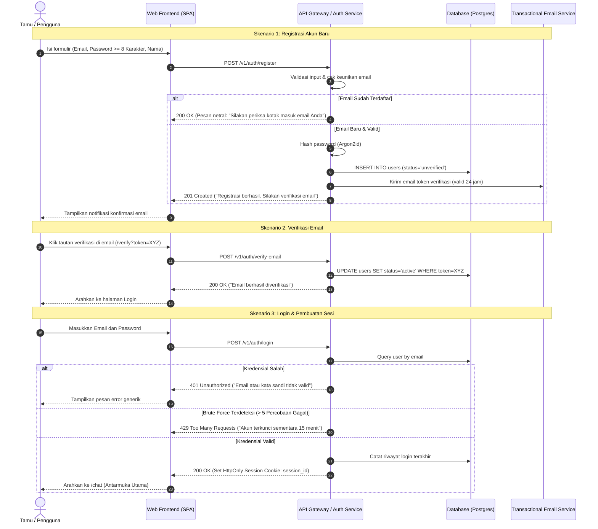
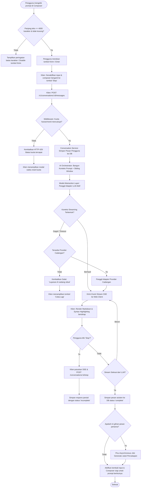
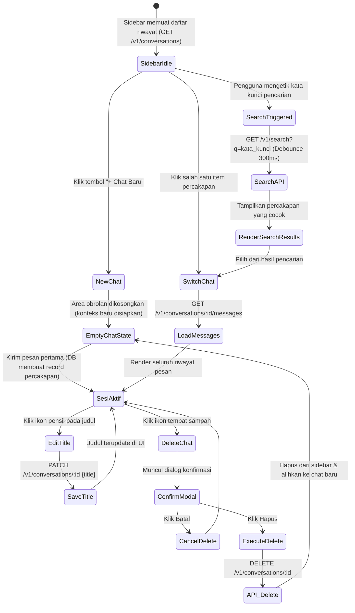
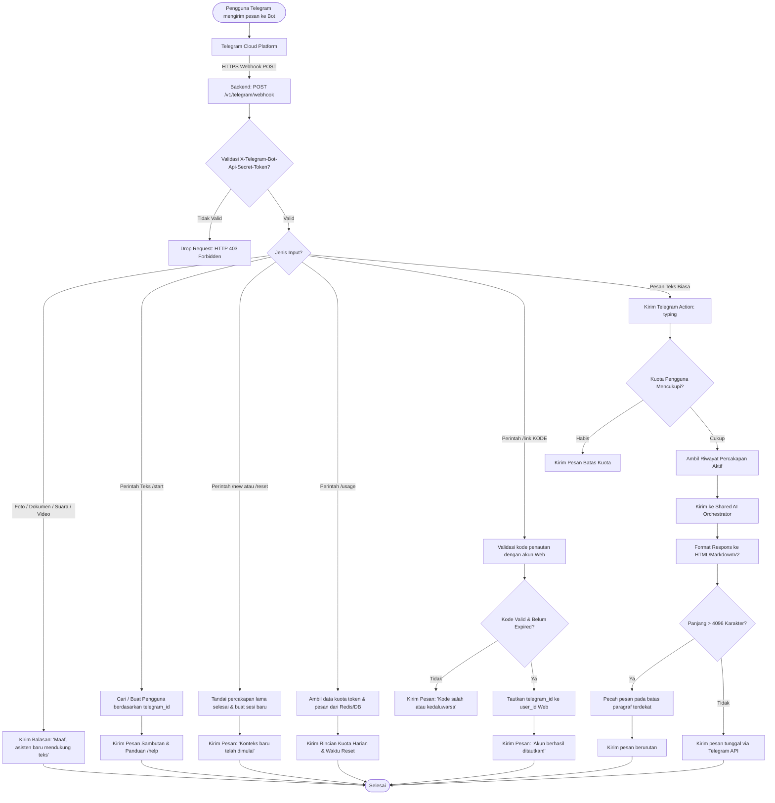
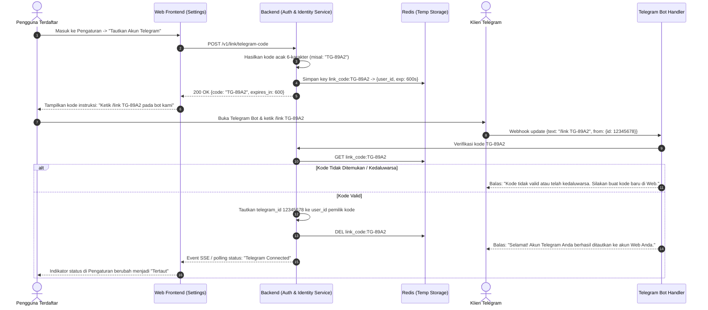

# User Flow: Multi-Platform General-Purpose AI Assistant

**Versi Dokumen:** 1.0  
**Tanggal:** 7 November 2026  
**Status:** Approved Baseline  
**Referensi:** PRD Section 15, Section 46, Section 20

---

## 1. Ikhtisar Alur Pengguna

Dokumen ini merinci seluruh alur interaksi pengguna (*user flows*) dan diagram alur (*state transitions*) pada platform Web dan bot Telegram, mencakup jalur utama (*happy path*), jalur alternatif, serta skenario penanganan galat (*error handling*).

---

## 2. Alur Registrasi, Verifikasi, dan Login (Web)

Pengguna baru harus membuat akun dan memverifikasi email sebelum dapat menggunakan layanan obrolan di aplikasi Web.



---

## 3. Alur Percakapan AI (Web Application)

Alur komprehensif mulai dari pengetikan pesan, validasi kuota, pengiriman ke LLM, respons streaming Server-Sent Events (SSE), hingga penyimpanan persisten.



---

## 4. Alur Pengelolaan Sesi Percakapan (Web)

Pengguna dapat menavigasi, mencari, mengubah nama, dan menghapus percakapan di area sidebar.



---

## 5. Alur Penggunaan Telegram Bot

Alur interaksi pengguna melalui Telegram Bot, mulai dari auto-provisioning hingga eksekusi perintah dan percakapan teks multi-turn.



---

## 6. Alur Penautan Akun (Web ke Telegram Linking Flow)

Sinkronisasi akun untuk menyatukan riwayat percakapan dan konsumsi kuota antara Web dan Telegram.



---

## 7. Alur Penanganan Galat & Ketahanan Sistem (Error Recovery Flow)

Alur komprehensif saat terjadi gangguan teknis pada penyedia eksternal LLM, jaringan terputus, atau kehabisan kuota pengguna.

```mermaid
flowchart TD
    ReqStart([Permintaan Inferensi AI Masuk]) --> CallLLM1[Panggil Model API Utama]
    
    CallLLM1 --> Result1{Status Pemanggilan?}
    
    Result1 -- HTTP 200 / Stream Sukses --> StreamBack[Lanjutkan Pengiriman Respons Normal]
    
    Result1 -- HTTP 429 Rate Limit Vendor --> ExponentialWait[Tunggu Backoff Eksponensial 1-2 Detik]
    ExponentialWait --> RetryLLM1[Retry Panggilan ke Vendor Utama Sekali]
    RetryLLM1 --> ResultRetry{Status Retry?}
    ResultRetry -- Berhasil --> StreamBack
    ResultRetry -- Gagal --> SwitchToBackup
    
    Result1 -- HTTP 500 / 503 / Network Timeout 60s --> SwitchToBackup[Alihkan ke Provider AI Cadangan / Fallback]
    
    SwitchToBackup --> CallLLM2[Panggil Model Cadangan via Adapter 2]
    CallLLM2 --> Result2{Status Provider Cadangan?}
    
    Result2 -- Berhasil --> StreamBackFallback[Kirim Respons (Log Event: Provider Fallback Active)]
    
    Result2 -- Gagal --> LogCorrelation[Catat Error Log + Correlation ID di Monitoring]
    LogCorrelation --> ReturnFriendlyError[Kirim Pesan Galat Bersahabat ke Pengguna]
    
    ReturnFriendlyError --> PlatformCheck{Platform Pengguna?}
    PlatformCheck -- Web --> ShowWebRetryUI[Tampilkan pesan: 'Layanan sedang mengalami gangguan sementara' + Tombol 'Coba Lagi']
    PlatformCheck -- Telegram --> SendTGErrMsg[Kirim Pesan: 'Mohon maaf, sistem sedang sibuk. Silakan coba beberapa saat lagi.']
```

