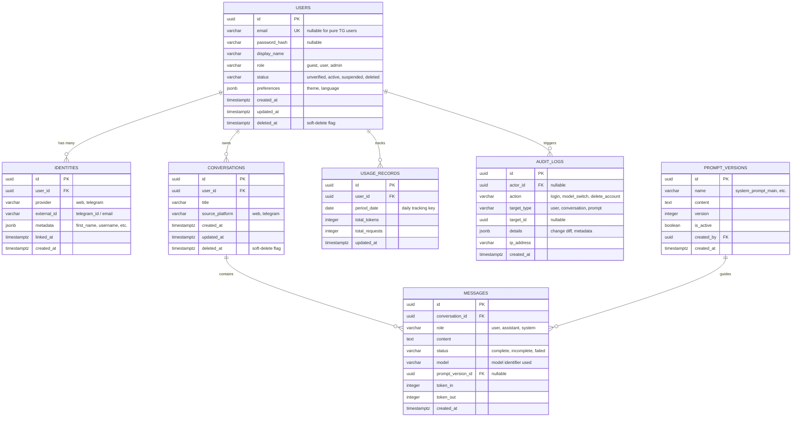

# Database Architecture & ERD: Multi-Platform General-Purpose AI Assistant

**Versi Dokumen:** 1.0  
**Tanggal:** 7 November 2026  
**Status:** Approved Technical Baseline  
**DBMS Target:** PostgreSQL 15+  
**Referensi:** PRD Section 41 (Database Requirements), DB-001 s.d. DB-004

---

## 1. Entity-Relationship Diagram (Mermaid ERD)



---

## 2. Table Definitions & Column Specifications

### 2.1 Tabel `users`
Menyimpan profil inti akun pengguna di seluruh platform.

| Kolom | Tipe Data | Nullable | Default | Deskripsi & Aturan Integritas |
| :--- | :--- | :--- | :--- | :--- |
| `id` | `UUID` | No | `gen_random_uuid()` | Primary Key (PK) |
| `email` | `VARCHAR(255)` | Yes | `NULL` | Alamat email unik (Case-Insensitive). Null jika pengguna mendaftar via Telegram dan belum ditautkan |
| `password_hash` | `VARCHAR(255)` | Yes | `NULL` | Hash password menggunakan Argon2id. Null jika murni akun Telegram |
| `display_name` | `VARCHAR(100)` | No | `'Pengguna'` | Nama panggilan pengguna yang ditampilkan di UI |
| `role` | `VARCHAR(20)` | No | `'user'` | Pilihan: `'user'`, `'admin'`. (Role `'guest'` diwakili sesi tanpa persistensi) |
| `status` | `VARCHAR(20)` | No | `'unverified'` | Pilihan: `'unverified'`, `'active'`, `'suspended'`, `'deleted'` |
| `preferences` | `JSONB` | No | `'{"theme":"system","language":"id"}'` | Preferensi UI (tema gelap/terang, bahasa tampilan) |
| `created_at` | `TIMESTAMPTZ` | No | `NOW()` | Waktu pembuatan akun |
| `updated_at` | `TIMESTAMPTZ` | No | `NOW()` | Waktu pembaruan profil terakhir |
| `deleted_at` | `TIMESTAMPTZ` | Yes | `NULL` | Penanda *soft-delete* akun (FR-024, DB-002) |

**Constraints:**
- `users_email_unique`: `UNIQUE (email) WHERE deleted_at IS NULL` (Mencegah duplikasi email aktif, namun mengizinkan re-registrasi setelah akun lama dihapus).

---

### 2.2 Tabel `identities`
Menghubungkan akun pengguna dengan saluran identitas eksternal (Telegram atau Web). Memungkinkan fitur **Account Linking** (FR-020).

| Kolom | Tipe Data | Nullable | Default | Deskripsi |
| :--- | :--- | :--- | :--- | :--- |
| `id` | `UUID` | No | `gen_random_uuid()` | Primary Key |
| `user_id` | `UUID` | No | - | Foreign Key mengarah ke `users(id)` ON DELETE CASCADE |
| `provider` | `VARCHAR(30)` | No | - | Pilihan saluran: `'web'`, `'telegram'` |
| `external_id` | `VARCHAR(100)` | No | - | ID unik penyedia (misal: `telegram_id` angka seperti `'123456789'`) |
| `metadata` | `JSONB` | Yes | `'{}'` | Data profil mentah dari provider (username Telegram, dll.) |
| `linked_at` | `TIMESTAMPTZ` | No | `NOW()` | Waktu ketika identitas ditautkan ke pengguna ini |
| `created_at` | `TIMESTAMPTZ` | No | `NOW()` | Waktu rekaman dibuat |

**Constraints:**
- `identities_provider_external_id_unique`: `UNIQUE (provider, external_id)` (Satu ID Telegram hanya boleh terhubung ke satu pengguna aktif).

---

### 2.3 Tabel `conversations`
Menyimpan sesi percakapan obrolan milik pengguna.

| Kolom | Tipe Data | Nullable | Default | Deskripsi |
| :--- | :--- | :--- | :--- | :--- |
| `id` | `UUID` | No | `gen_random_uuid()` | Primary Key |
| `user_id` | `UUID` | No | - | Foreign Key ke `users(id)` ON DELETE CASCADE |
| `title` | `VARCHAR(150)` | No | `'Percakapan Baru'` | Judul obrolan (otomatis dibuat atau diedit pengguna) |
| `source_platform` | `VARCHAR(20)` | No | `'web'` | Platform inisiasi: `'web'`, `'telegram'` |
| `created_at` | `TIMESTAMPTZ` | No | `NOW()` | Waktu dibuat |
| `updated_at` | `TIMESTAMPTZ` | No | `NOW()` | Waktu pembaruan pesan terakhir (kunci sorting sidebar) |
| `deleted_at` | `TIMESTAMPTZ` | Yes | `NULL` | Penanda *soft-delete* percakapan (FR-009) |

**Constraints:**
- `conversations_user_id_fk`: Foreign Key ke `users(id)`.

---

### 2.4 Tabel `messages`
Menyimpan setiap butir pesan dalam sesi percakapan (baik dari pengguna maupun asisten AI).

| Kolom | Tipe Data | Nullable | Default | Deskripsi |
| :--- | :--- | :--- | :--- | :--- |
| `id` | `UUID` | No | `gen_random_uuid()` | Primary Key |
| `conversation_id`| `UUID` | No | - | Foreign Key ke `conversations(id)` ON DELETE CASCADE |
| `role` | `VARCHAR(20)` | No | - | Pilihan peran: `'user'`, `'assistant'`, `'system'` |
| `content` | `TEXT` | No | - | Isi pesan teks lengkap |
| `status` | `VARCHAR(20)` | No | `'complete'` | Pilihan: `'complete'`, `'incomplete'`, `'failed'` |
| `model` | `VARCHAR(100)` | Yes | `NULL` | Nama model AI yang menghasilkan pesan (misal: `'gpt-4o'`, `'gemini-1.5-pro'`) |
| `prompt_version_id`| `UUID` | Yes | `NULL` | FK ke `prompt_versions(id)` yang digunakan saat inferensi |
| `token_in` | `INTEGER` | No | `0` | Jumlah token prompt input |
| `token_out` | `INTEGER` | No | `0` | Jumlah token jawaban output |
| `created_at` | `TIMESTAMPTZ` | No | `NOW()` | Waktu pengiriman pesan |

---

### 2.5 Tabel `usage_records`
Mencatat agregasi penggunaan kuota token dan frekuensi permintaan harian per pengguna.

| Kolom | Tipe Data | Nullable | Default | Deskripsi |
| :--- | :--- | :--- | :--- | :--- |
| `id` | `UUID` | No | `gen_random_uuid()` | Primary Key |
| `user_id` | `UUID` | No | - | Foreign Key ke `users(id)` ON DELETE CASCADE |
| `period_date` | `DATE` | No | `CURRENT_DATE`| Tanggal pencatatan (format: `YYYY-MM-DD`) |
| `total_tokens` | `INTEGER` | No | `0` | Total konsumsi token pada tanggal terkait |
| `total_requests`| `INTEGER` | No | `0` | Total jumlah pesan yang dikirimkan pengguna |
| `updated_at` | `TIMESTAMPTZ` | No | `NOW()` | Waktu kalkulasi pembaruan terakhir |

**Constraints:**
- `usage_user_period_unique`: `UNIQUE (user_id, period_date)` (Satu baris per pengguna per hari).

---

### 2.6 Tabel `prompt_versions`
Mengelola versi *System Prompt* aktif tanpa membutuhkan *deployment* ulang aplikasi (FR-025, PM-001).

| Kolom | Tipe Data | Nullable | Default | Deskripsi |
| :--- | :--- | :--- | :--- | :--- |
| `id` | `UUID` | No | `gen_random_uuid()` | Primary Key |
| `name` | `VARCHAR(50)` | No | `'main_system'`| Nama identifikasi template prompt |
| `content` | `TEXT` | No | - | Teks instruksi system prompt lengkap |
| `version` | `INTEGER` | No | `1` | Nomor versi bertahap |
| `is_active` | `BOOLEAN` | No | `false` | Status prompt yang sedang aktif digunakan |
| `created_by` | `UUID` | Yes | `NULL` | FK ke `users(id)` admin yang membuat versi ini |
| `created_at` | `TIMESTAMPTZ` | No | `NOW()` | Waktu pembuatan versi prompt |

---

### 2.7 Tabel `audit_logs`
Merekam jejak audit operasional sistem dan aktivitas administratif untuk kepatuhan dan keamanan (MON-005).

| Kolom | Tipe Data | Nullable | Default | Deskripsi |
| :--- | :--- | :--- | :--- | :--- |
| `id` | `UUID` | No | `gen_random_uuid()` | Primary Key |
| `actor_id` | `UUID` | Yes | `NULL` | ID admin/user yang melakukan aksi |
| `action` | `VARCHAR(50)` | No | - | Nama aksi: `'LOGIN'`, `'SUSPEND_USER'`, `'UPDATE_PROMPT'` |
| `target_type` | `VARCHAR(50)` | Yes | `NULL` | Entitas target: `'USER'`, `'PROMPT'`, `'CONFIG'` |
| `target_id` | `UUID` | Yes | `NULL` | ID entitas target terkait |
| `details` | `JSONB` | Yes | `'{}'` | Snapshot perubahan data (diff sebelum & sesudah) |
| `ip_address` | `VARCHAR(45)` | Yes | `NULL` | Alamat IP pengakses |
| `created_at` | `TIMESTAMPTZ` | No | `NOW()` | Waktu pencatatan audit |

---

## 3. Indexing Recommendations

Untuk memenuhi target performa p95 TTFT dan pemuatan riwayat ≤ 2.0 detik (NFR-001), indeks berikut wajib dibuat:

```sql
-- 1. Optimasi Pemuatan Sidebar Percakapan Pengguna (FR-006)
CREATE INDEX idx_conversations_user_updated 
ON conversations (user_id, updated_at DESC) 
WHERE deleted_at IS NULL;

-- 2. Optimasi Pemuatan Pesan dalam Percakapan (FR-004)
CREATE INDEX idx_messages_conversation_created 
ON messages (conversation_id, created_at ASC);

-- 3. Optimasi Penautan Telegram & Pencarian Identitas (FR-016, FR-020)
CREATE UNIQUE INDEX idx_identities_provider_external 
ON identities (provider, external_id);

-- 4. Optimasi Pencarian Teks Percakapan (Full-Text Search / GIN Index) (FR-008)
CREATE INDEX idx_conversations_title_trgm 
ON conversations USING gin (title gin_trgm_ops) 
WHERE deleted_at IS NULL;

CREATE INDEX idx_messages_content_trgm 
ON messages USING gin (content gin_trgm_ops);

-- 5. Optimasi Pengecekan Kuota Pengguna (FR-022)
CREATE INDEX idx_usage_user_date 
ON usage_records (user_id, period_date);
```

---

## 4. Database Constraints & Data Retention Strategy

1. **Foreign Key Referencing & Cascading:**
   - Menghapus record pengguna (`users`) akan memicu `CASCADE` pada `identities`, `conversations`, dan `messages`.
   - Namun, pada operasional normal, aplikasi memberlakukan **Soft-Delete** (`deleted_at IS NOT NULL`). Data dengan flag soft-delete tidak akan dimuat oleh API reguler.
2. **Permanent Data Purging (Cron Job Otomatis):**
   - Sesuai kebijakan retensi privasi (FR-024, DB-002), cron job terjadwal berjalan setiap malam untuk mengeksekusi penghapusan permanen (*hard delete*) bagi seluruh data yang memiliki `deleted_at < NOW() - INTERVAL '30 days'`.
3. **Audit Log Immutability:**
   - Tabel `audit_logs` diberi aturan izin database (*PostgreSQL permissions*): hanya memiliki hak `INSERT` dan `SELECT`. Perintah `UPDATE` dan `DELETE` dinonaktifkan di tingkat DB user untuk menjamin integritas forensik log.

