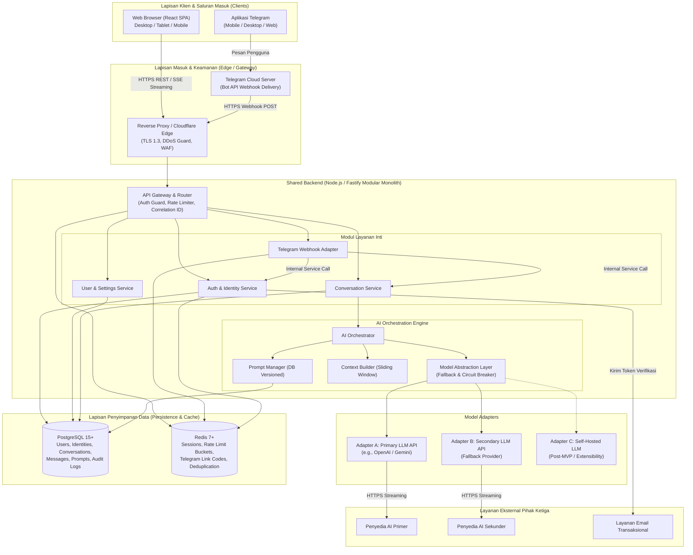
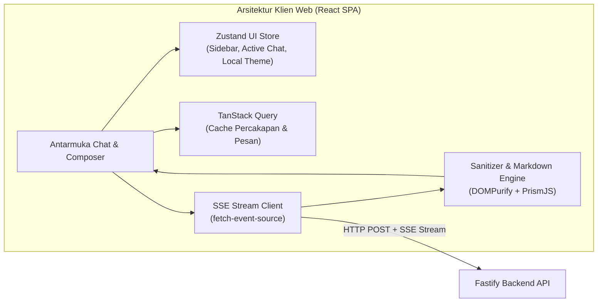
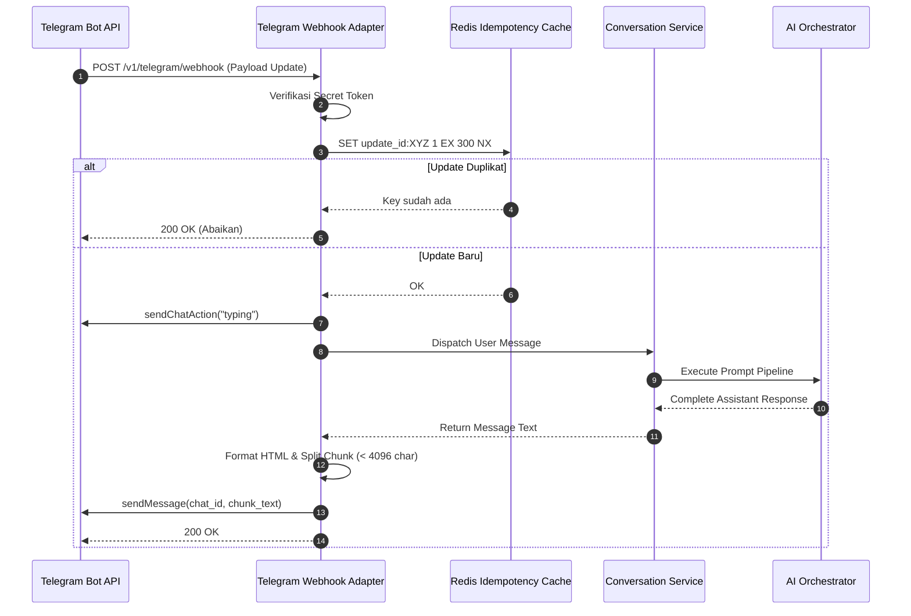
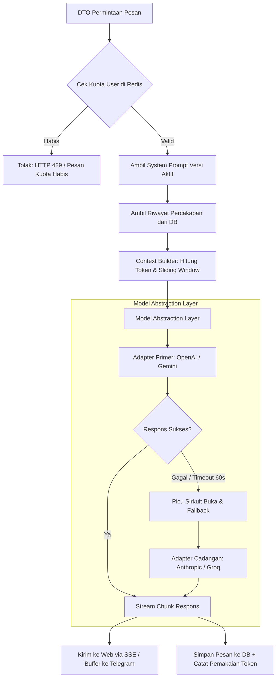
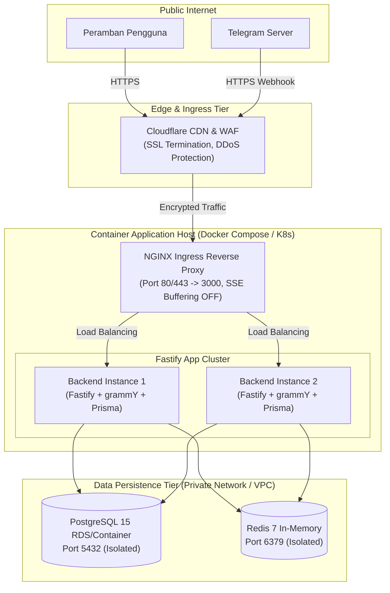

# System Architecture: Multi-Platform General-Purpose AI Assistant

**Versi Dokumen:** 1.0  
**Tanggal:** 7 November 2026  
**Status:** Approved Technical Baseline  
**Referensi:** PRD Section 36 (System Architecture), Section 37-39

---

## 1. High-Level Architecture Overview

Sistem mengadopsi pola **API-First Unified Backend Architecture**. Seluruh antarmuka pengguna—baik aplikasi Web Single-Page Application (SPA) maupun bot perpesanan Telegram—berkomunikasi dengan satu lapisan backend terpadu. Pendekatan ini menjamin bahwa seluruh aturan bisnis, perakitan prompt AI, pembatasan kuota (*rate limiting*), dan isolasi data diterapkan secara seragam dan konsisten.



---

## 2. Component Architecture Breakdown

### 2.1 Web Frontend Architecture (React SPA)
Frontend Web dikembangkan sebagai Single-Page Application (SPA) yang sepenuhnya terpisah dari server backend:
- **Routing & Navigation:** Menggunakan *React Router* untuk memisahkan rute publik (`/login`, `/register`, `/verify-email`) dan rute terproteksi (`/chat`, `/chat/:conversationId`, `/settings`).
- **SSE Stream Consumer:** Menggunakan utilitas `fetch-event-source` untuk mengonsumsi Server-Sent Events (SSE) dari endpoint `POST /v1/conversations/:id/messages`. Menangani pemrosesan chunk per kata secara reaktif tanpa re-render berlebihan.
- **Markdown & Code Parser:** Komponen renderer menggunakan `react-markdown` yang dipadukan dengan plugin `remark-gfm` (tabel, task list) dan `rehype-highlight` / `rehype-prism` untuk pewarnaan blok kode. Seluruh keluaran disanitasi menggunakan `rehype-sanitize` untuk menangkal serangan XSS.
- **State Store:** 
  - *Server State:* `TanStack Query` mengelola caching daftar percakapan, pesan, dan status kuota.
  - *UI State:* `Zustand` menyimpan status sidebar (buka/tutup), modal konfirmasi, preferensi tema lokal, dan buffer input composer.



---

### 2.2 Telegram Integration Architecture (Adapter Pattern)
Komponen Telegram Bot dirancang sebagai *adapter tipis* (*thin inbound/outbound adapter*):
- **Inbound Webhook Verification:** Memvalidasi header `X-Telegram-Bot-Api-Secret-Token`. Jika tidak cocok, request langsung ditolak (HTTP 403).
- **Idempotency Guard:** `update_id` dari setiap payload Telegram disimpan di Redis menggunakan perintah `SET update_id:<id> 1 EX 300 NX`. Jika update duplikat tiba akibat retry Telegram, request langsung dibalas HTTP 200 tanpa dieksekusi ulang.
- **Message Dispatcher:**
  - Perintah bot (`/start`, `/help`, `/new`, `/reset`, `/link`, `/usage`) diterjemahkan menjadi pemanggilan fungsi domain internal.
  - Pesan teks diteruskan ke `ConversationService.sendMessage()`.
  - Pesan non-teks langsung dibalas dengan pesan edukasi batas layanan tanpa memicu AI.
- **Outbound Chunking & Formatting:** Mengubah teks Markdown keluaran AI menjadi format Telegram HTML/MarkdownV2. Jika panjang melebihi 4.096 karakter, adapter memecah pesan berdasarkan jeda paragraf (`\n\n`) atau baris baru (`\n`) secara deterministik.



---

### 2.3 Backend Core & AI Orchestration Architecture
AI Orchestrator adalah gerbang tunggal pemanggilan model LLM:
1. **Sanitasi & Validasi Input:** Memastikan prompt tidak melebihi batas panjang karakter (4.000 karakter).
2. **Quota Check:** Memeriksa saldo kuota harian/bulanan di Redis.
3. **Prompt Manager:** Mengambil `system_prompt` versi aktif dari cache/DB.
4. **Context Builder (Sliding Window):**
   - Menghitung token pesan baru dan system prompt.
   - Mengambil pesan riwayat percakapan secara *reverse-chronological* (dari pesan terbaru ke terlama).
   - Menambahkan pesan riwayat selama total token tidak melampaui batas jendela konteks model (menyisakan cadangan 20% untuk output generasi).
5. **Model Abstraction & Circuit Breaker:**
   - Memilih adapter penyedia model aktif (Provider A).
   - Membuka stream ke API penyedia.
   - Jika terjadi network error, HTTP 5xx, atau timeout > 60 detik, router otomatis memutus sirkuit dan mengalihkan permintaan ke Adapter Provider B (Fallback).
6. **Persistence & Token Accounting:** Menyimpan teks akhir, menghitung konsumsi token aktual (input & output), dan mencatatnya ke tabel `messages` dan `usage_records`.



---

## 4. Communication Flow & Protocols

| Saluran / Kanal Komunikasi | Protokol | Format Payload | Pola Interaksi |
| :--- | :--- | :--- | :--- |
| **Web Client ↔ API Backend** | HTTPS / TLS 1.3 | JSON (Request/Response) | REST API standar |
| **Web Chat ↔ AI Streaming** | HTTP/1.1 atau HTTP/2 | Server-Sent Events (`text/event-stream`) | Streaming searah (Server to Client) |
| **Telegram Cloud ↔ Backend** | HTTPS Webhook | JSON (Telegram Update Object) | Asynchronous Webhook Push |
| **Backend ↔ Database (Postgres)** | TCP (Port 5432) | Binary PostgreSQL Wire Protocol | Connection Pooling (Prisma/pgBouncer) |
| **Backend ↔ Cache (Redis)** | TCP (Port 6379) | RESP (REdis Serialization Protocol) | In-Memory KVS Operasi O(1) |
| **Backend ↔ External AI Providers** | HTTPS / TLS 1.3 | Server-Sent Events / JSON REST | Asynchronous HTTP Streaming |

---

## 5. Deployment Architecture (Production Target)

Arsitektur deployment dirancang berbasis kontainer Docker yang portabel, dapat dijalankan pada infrastruktur Cloud VPS (seperti AWS Lightsail, DigitalOcean, Hetzner) maupun layanan PaaS/Kubernetes.



### Konfigurasi Kritis NGINX untuk Streaming SSE:
Untuk mencegah NGINX melakukan *buffering* pada respon streaming token AI (yang dapat merusak pengalaman real-time pengguna), NGINX wajib dikonfigurasi dengan direktif:
```nginx
proxy_buffering off;
proxy_cache off;
proxy_set_header Connection '';
proxy_http_version 1.1;
chunked_transfer_encoding on;
proxy_read_timeout 120s;
```

