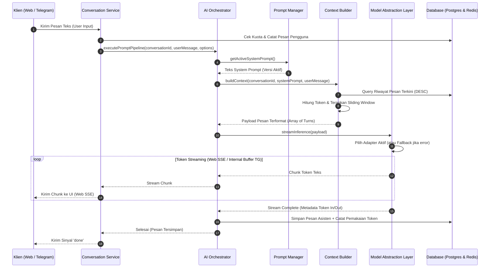
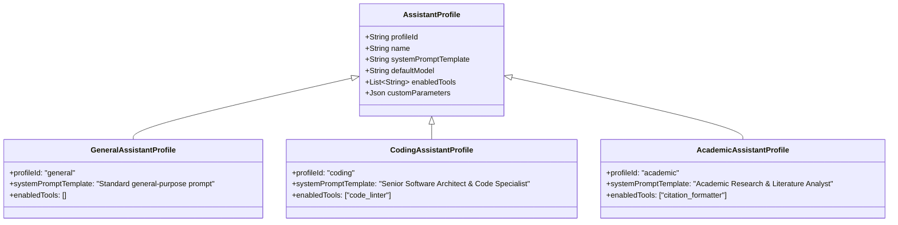

# AI Orchestration Pipeline: Multi-Platform General-Purpose AI Assistant

**Versi Dokumen:** 1.0  
**Tanggal:** 7 November 2026  
**Status:** Approved AI Engineering Baseline  
**Referensi:** PRD Section 29 (AI Orchestration), Section 31 (Context Management), Section 54 (Future Improvements)

---

## 1. Request Lifecycle Overview

AI Orchestrator bertindak sebagai **jantung pemrosesan inferensi kecerdasan buatan terpusat**. Klien Web dan adapter Telegram tidak memiliki logika AI mandiri—keduanya memanggil *Conversation Service* yang mendelegasikan perakitan dan eksekusi prompt ke AI Orchestrator.



---

## 2. Step-by-Step Orchestration Stages

### Tahap 1: Validasi, Sanitasi & Pemeriksaan Kuota
- **Input Sanitization:** Menghapus karakter kontrol terlarang (*null bytes*), memotong spasi kosong di awal/akhir, dan memvalidasi panjang string (maksimal 4.000 karakter).
- **Quota Guard:** Memeriksa saldo kuota token pengguna di Redis. Jika saldo habis, alur langsung diputus dan melempar eksepsi `QuotaExceededException` (HTTP 429).

### Tahap 2: Prompt Assembly & Security Delimitation
Prompt disusun menggunakan struktur hierarkis yang memisahkan instruksi sistem dari input pengguna:
```json
[
  {
    "role": "system",
    "content": "{{active_system_prompt}}"
  },
  {
    "role": "user",
    "content": "Pesan riwayat masa lalu..."
  },
  {
    "role": "assistant",
    "content": "Jawaban asisten masa lalu..."
  },
  {
    "role": "user",
    "content": "<user_input>\n{{sanitized_current_user_message}}\n</user_input>"
  }
]
```
Tag pembungkus `<user_input>` memastikan bahwa instruksi sistem tidak dapat ditimpa oleh masukan pengguna (*prompt injection mitigation*).

### Tahap 3: Context Injection (Sliding Window Algorithm)
1. Hitung token untuk `system_prompt` ($T_{sys}$) dan pesan pengguna baru ($T_{user}$).
2. Tentukan batas maksimal token konteks masukan:
   $$T_{budget} = T_{model\_context\_limit} - T_{output\_reservation} - T_{sys} - T_{user}$$
   *(Contoh: Model dengan limit 8.192 token, alokasi output 2.048 token, menyisakan 6.144 token untuk input riwayat).*
3. Kueri riwayat pesan pada percakapan terkait secara berurutan dari yang paling baru ke terlama (`ORDER BY created_at DESC`).
4. Iterasi pesan riwayat: hitung token masing-masing pesan. Selama akumulasi token $\le T_{budget}$, pesan dimasukkan ke dalam daftar konteks. Jika melebihi anggaran, hentikan iterasi (pesan-pesan yang lebih tua diabaikan).
5. Balikkan kembali urutan riwayat pesan terpilih menjadi kronologis (`ASC`) sebelum dikirimkan ke model.

### Tahap 4: Model Selection & Streaming Execution
- Memuat adapter penyedia model aktif dari registry konfigurasi runtime.
- Membuka koneksi stream HTTP (Server-Sent Events) ke API penyedia model AI.
- Mengalirkan setiap delta token ke klien secara *real-time*.

### Tahap 5: Response Processing & Sanitization
- Potongan teks stream disalurkan langsung ke klien Web untuk menjaga TTFT p95 ≤ 3.0 detik.
- Di sisi klien Web, teks di-escape dan disanitasi menggunakan DOMPurify sebelum di-parse menjadi elemen Markdown HTML untuk menangkal potensi serangan Stored XSS.

### Tahap 6: Conversation Persistence & Asynchronous Tasks
- Setelah aliran token selesai dari LLM:
  1. Gabungkan seluruh delta teks menjadi satu pesan utuh.
  2. Catat jumlah `token_in` dan `token_out` aktual.
  3. Simpan baris baru ke tabel `messages` dengan status `complete`.
  4. Perbarui timestamp `updated_at` pada tabel `conversations`.
  5. Perbarui agregasi konsumsi token pada tabel `usage_records`.
- **Asynchronous Title Generation:** Jika percakapan tersebut baru memiliki 1 giliran pesan (1 user + 1 assistant), picu background task terpisah untuk menghasilkan judul singkat otomatis (≤ 5 kata) menggunakan model ringan tanpa menghambat respons obrolan.

---

## 3. Extensibility: Future Specialized AI Assistant Profiles

Untuk mengakomodasi visi produk masa depan tanpa mempersulit arsitektur MVP, sistem mengimplementasikan pola **Assistant Profile Pattern**:



### Bagaimana Profil Spesialisasi Bekerja di Masa Depan:
1. **MVP Simplicity:** Pada fase MVP, sistem hanya mendaftarkan satu profil tunggal: `GeneralAssistantProfile` dengan `enabledTools: []`.
2. **Post-MVP Extensibility:** Saat ingin menambahkan kemampuan spesialisasi (seperti *Coding Assistant*, *Academic Assistant*, *Business Assistant*):
   - Pengembang **tidak perlu merombak orkestrator atau basis data**.
   - Pengembang cukup menambahkan record profil baru di tabel konfigurasi profil yang memuat template prompt khusus dan daftar tools yang diizinkan.
   - Orkestrator secara dinamis memuat profil berdasarkan preferensi pengguna atau ID sesi percakapan.

