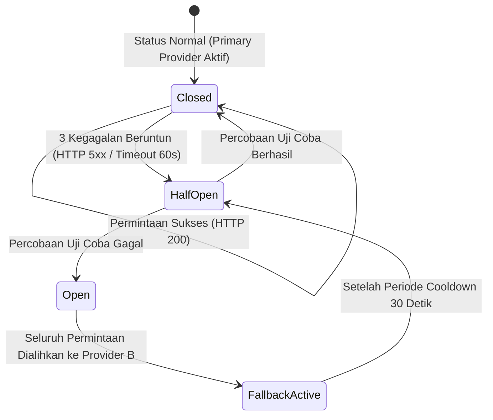
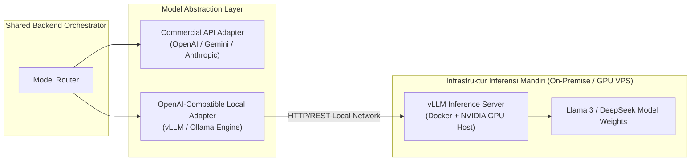

# Model Strategy & Provider Abstraction: Multi-Platform General-Purpose AI Assistant

**Versi Dokumen:** 1.0  
**Tanggal:** 7 November 2026  
**Status:** Approved AI Engineering Baseline  
**Referensi:** PRD Section 28 (AI Model Integration), Section 35 (Token & Usage Management), OBJ-03, NFR-011

---

## 1. Multi-Provider Abstraction Architecture

Prinsip utama arsitektur AI pada proyek ini adalah **Vendor Neutrality (Kemandirian Terhadap Vendor)**. Sistem tidak boleh terikat (*hard-coupled*) dengan SDK atau format proprietary dari satu penyedia LLM komersial.

Orkestrator backend hanya berinteraksi dengan antarmuka seragam `AIProviderAdapter`:

```typescript
export interface GenerationParams {
  systemPrompt: string;
  messages: Array<{ role: 'user' | 'assistant'; content: string }>;
  temperature?: number;
  maxTokens?: number;
  correlationId: string;
}

export interface StreamChunk {
  delta: string;
  finishReason?: 'stop' | 'length' | 'error';
  tokenUsage?: {
    promptTokens: number;
    completionTokens: number;
  };
}

export interface AIProviderAdapter {
  readonly providerId: string;
  readonly modelName: string;
  
  /** Menghasilkan teks lengkap (non-streaming) */
  generate(params: GenerationParams): Promise<{ text: string; tokenIn: number; tokenOut: number }>;
  
  /** Menghasilkan teks ber-streaming (AsyncGenerator) */
  stream(params: GenerationParams): AsyncIterable<StreamChunk>;
  
  /** Menghitung estimasi token untuk sliding window */
  countTokens(text: string): number;
  
  /** Pemeriksaan kesehatan koneksi API penyedia */
  healthCheck(): Promise<boolean>;
}
```

---

## 2. Model Selection & Adapter Implementation (MVP)

Pada fase MVP, sistem menyiapkan minimal **2 adapter penyedia model eksternal** yang operasional untuk membuktikan fleksibilitas penggantian model dan mekanisme fallback (OBJ-03, Acceptance Criteria PRD):

| Peran Provider | Kandidat Vendor & Model | Alasan Pemilihan & Karakteristik |
| :--- | :--- | :--- |
| **Primary Provider (Adapter A)** | **OpenAI (GPT-4o-mini / GPT-4o)** atau **Google Gemini 1.5 Flash / Pro** | Kemampuan pemahaman Bahasa Indonesia yang sangat baik, latensi TTFT rendah (< 2s), throughput streaming stabil, dan harga per 1M token yang kompetitif. |
| **Secondary Provider (Adapter B - Fallback)** | **Anthropic Claude 3.5 Sonnet** atau **Groq Llama 3.3 70B** | Model berkualitas tinggi untuk cadangan instan saat provider primer mengalami HTTP 500, rate limit (429), atau downtime jaringan. |

---

## 3. Dynamic Model Switching & Routing Strategy

Sistem memisahkan pemilihan model dari kode sumber program. Penentuan model aktif dikendalikan melalui tabel database `app_configurations` atau variabel lingkungan dengan hirarki prioritas:

```
[Permintaan Masuk]
       │
       ▼
[Cek Konfigurasi Runtime di Redis/DB]
  ├── Default Provider: "gemini" / Model: "gemini-1.5-flash"
  └── Fallback Provider: "openai" / Model: "gpt-4o-mini"
       │
       ▼
[Router Memuat Instance Adapter Terkait]
```

- **Perubahan Tanpa Redeploy:** Administrator dapat mengubah penyedia aktif melalui konfigurasi runtime (FR-025). Permintaan obrolan berikutnya langsung menggunakan model baru dalam waktu < 1 detik tanpa mematikan proses server backend.
- **Model Routing Per Task (Post-MVP Extensibility):**
  - Tugas percakapan ringan & ringkasan: Dialihkan ke model cepat dan hemat biaya (Flash/Mini).
  - Tugas pemrograman rumit & analisis logika: Dialihkan ke model *high-reasoning* (Pro/Plus).

---

## 4. Fallback Strategy & Circuit Breaker Pattern

Untuk menjamin ketersediaan sistem ≥ 99.0% (OBJ-06, NFR-003), Model Router mengimplementasikan pola **Circuit Breaker**:



### Aturan Eksekusi Fallback:
1. **Percobaan Panggilan Pertama:** Kirim permintaan ke Penyedia Utama.
2. **Penanganan Error Spesifik:**
   - *HTTP 429 (Rate Limit Vendor):* Sistem menerapkan *exponential backoff* singkat (1 detik), lalu melakukan 1 kali retry.
   - *HTTP 500 / 503 / Connection Timeout (> 60 detik):* Sistem mencatat peringatan di log dan **seketika mengalihkan payload permintaan ke Penyedia Sekunder (Fallback)**.
3. **Maksimal Percobaan:** Total percobaan maksimal adalah 2 kali sebelum mengembalikan pesan galat bersahabat kepada pengguna (FR-023).

---

## 5. Self-Hosted Model Strategy (Post-MVP Roadmap)

Meskipun MVP memprioritaskan API model komersial eksternal [FAKTA], arsitektur backend telah disiapkan untuk mengadopsi model *self-hosted* (*open-source* LLM seperti Llama 3, Mistral, atau DeepSeek) pada tahap lanjut:



### Kesiapan Teknis Self-Hosted:
- Engine server seperti **vLLM** atau **Ollama** menyediakan endpoint API yang 100% kompatibel dengan standar antarmuka OpenAI (`/v1/chat/completions`).
- Pengalihan ke self-hosted model di masa depan cukup dilakukan dengan mendaftarkan instance adapter `SelfHostedOpenAICompatibleAdapter` dengan URL base lokal (misal: `http://gpu-worker-01:8000/v1`), tanpa mengubah satu baris pun kode logika percakapan.

---

## 6. Token & Cost Management Guardrails

Untuk mencegah pembengkakan biaya token (Risiko R-01 pada PRD):

1. **Estimasi & Pemangkasan Konteks:** Menggunakan tokenizer lokal berbasis WebAssembly (`tiktoken` / `gpt-tokenizer`) untuk menghitung jumlah token riwayat sebelum dikirim ke vendor, mencegah pemborosan token pada pesan yang terlalu tua.
2. **Batas Input Maksimal:** Membatasi input prompt pengguna maksimal 4.000 karakter (~1.000 token).
3. **Batas Output Maksimal (`max_tokens`):** Mengatur parameter `max_tokens: 2048` pada pemanggilan LLM untuk mencegah jawaban *looping* tanpa batas yang menguras biaya.
4. **Pencatatan Akuntansi Token:** Setiap giliran pesan mencatat jumlah `token_in` dan `token_out` aktual yang dilaporkan oleh penyedia LLM ke tabel `messages` dan tabel `usage_records`.
5. **Ambang Batas Peringatan Biaya (Budget Alert):** Cron job operasional memeriksa konsumsi biaya harian. Jika pemakaian token agregat mencapai 80% dari anggaran harian yang ditetapkan, sistem mengirimkan notifikasi alert via webhook ke administrator (TK-005).

