# Development Roadmap & Milestones: Multi-Platform General-Purpose AI Assistant

**Versi Dokumen:** 1.0  
**Tanggal:** 7 November 2026  
**Status:** Approved Engineering Baseline  
**Referensi:** PRD Section 48 (Development Roadmap), Section 26 (Acceptance Criteria MVP)

---

## 1. Roadmap Principles & Structure

Roadmap proyek disusun berdasarkan **urutan ketergantungan logis (phase-driven dependency)** dan pencapaian tonggak keberhasilan (*milestones*), bukan kalender kaku, guna memastikan fondasi sistem teruji secara kokoh sebelum fitur lanjutan dibangun di atasnya.

```mermaid
gantt
    title Fase Pengembangan Proyek AI Assistant (Urutan Logis)
    dateFormat  X
    axisFormat  Fase %s

    section Fase 0: Discovery & Setup
    Penyelesaian Keputusan TBD & Setup Repo           :0, 1
    
    section Fase 1: Fondasi Arsitektur
    Database Schema, Auth Module, AI Model Adapter 1  :1, 2
    
    section Fase 2: Inti Chat & Web UI
    Conversation Service, SSE Streaming, React SPA UI :2, 3
    
    section Fase 3: Integrasi Telegram
    grammY Webhook, Bot Commands, Account Linking    :3, 4
    
    section Fase 4: Hardening & Keamanan
    Adapter 2 Fallback, Rate Limiting, Pentest, E2E  :4, 5
    
    section Fase 5: Pilot & Evaluasi
    Rilis Terbatas, Pemantauan Token, Baseline KPIs   :5, 6
```

---

## 2. Detailed Phase Breakdown & Deliverables

### Fase 0: Discovery & Arsitektur Baseline (Tahap Saat Ini)
- **Fokus:** Penyelarasan kebutuhan, pembekuan dokumen spesifikasi teknis, dan pemilihan komponen awal.
- **Keluaran Utama (Deliverables):**
  - Seluruh dokumen spesifikasi produk, teknis, UI/UX, AI, dan dev plan tuntas dan konsisten.
  - Template konfigurasi *environment* (`.env.example`) dan skema data baseline.
- **Kriteria Selesai (Milestone M0):** Stakeholder menyetujui seluruh dokumen perencanaan dan PRD v1.0 dibekukan.

### Fase 1: Fondasi Backend & Abstraksi AI
- **Fokus:** Setup scaffolding backend Node.js Fastify, konektivitas database PostgreSQL via Prisma/Drizzle, modul autentikasi, dan abstraksi model AI pertama.
- **Keluaran Utama (Deliverables):**
  - Kerangka *Modular Monolith* Fastify + TypeScript.
  - Skema database termigrasi (`users`, `identities`, `conversations`, `messages`, `prompt_versions`).
  - Endpoint registrasi, login, logout, dan verifikasi email berfungsi penuh (AUTH-001 s.d. AUTH-005).
  - Implementasi `AIProviderAdapter` pertama (Adapter Primer: OpenAI atau Gemini) dengan pengujian streaming token via unit test.
- **Kriteria Selesai (Milestone M1):** Pengguna dapat login dan backend berhasil melakukan panggilan streaming ke API LLM via script uji.

### Fase 2: Inti Percakapan & Aplikasi Web (Core Web Chat)
- **Fokus:** Membangun *Conversation Service*, *AI Orchestrator* (Context Builder & Sliding Window), dan antarmuka Web Chat SPA (React + Tailwind CSS).
- **Keluaran Utama (Deliverables):**
  - Endpoint REST & SSE untuk pengiriman pesan (`POST /conversations/:id/messages`).
  - Antarmuka Chat Web: sidebar riwayat percakapan, layout responsif (desktop, tablet, mobile), composer multi-line, rendering Markdown & blok kode dengan tombol salin.
  - Fitur kontrol: Stop streaming, Regenerate, Edit prompt, dan ganti judul percakapan.
- **Kriteria Selesai (Milestone M2):** Seluruh Functional Requirement (FR) bertaraf **Must Have** pada platform Web lulus uji fungsional dan pengujian integrasi.

### Fase 3: Integrasi Telegram Bot & Sinkronisasi Akun
- **Fokus:** Implementasi Telegram Adapter (grammY), penanganan webhook aman, percakapan *multi-turn*, dan fitur *Account Linking*.
- **Keluaran Utama (Deliverables):**
  - Endpoint `POST /v1/telegram/webhook` dengan verifikasi token rahasia dan deduplikasi `update_id`.
  - Eksekusi perintah bot: `/start`, `/help`, `/new`, `/reset`, `/usage`, `/link`.
  - Penolakan ramah terhadap berkas/gambar non-teks.
  - Alur *Account Linking* via kode OTP 6-karakter untuk menyatukan percakapan Web dan Telegram.
- **Kriteria Selesai (Milestone M3):** Pengguna dapat berinteraksi kontekstual di Telegram dan melihat riwayat obrolannya muncul di aplikasi Web setelah ditautkan.

### Fase 4: Pengerasan Sistem, Keamanan & Adapter Kedua (Hardening)
- **Fokus:** Implementasi adapter AI kedua (fallback), *rate limiting* Redis, logging terstruktur, dan penutupan celah keamanan.
- **Keluaran Utama (Deliverables):**
  - Adapter Model AI Sekunder (Fallback) aktif dengan pengujian otomatis *circuit breaker* saat provider utama offline.
  - Penegakan kuota token harian dan pembatasan frekuensi request via Redis.
  - Sanitasi HTML (DOMPurify) dan uji penetrasi keamanan terhadap prompt injection dan akses silang antar pengguna (*data isolation*).
  - Audit logging dan metrik observabilitas dengan Correlation ID.
- **Kriteria Selesai (Milestone M4):** Sistem mencapai status **Release Candidate (RC)**; seluruh Acceptance Criteria MVP (Section 26 PRD) terpenuhi.

### Fase 5: Pilot Terbatas & Evaluasi Metrik
- **Fokus:** Peluncuran internal / rilis uji coba terbatas (*closed beta*) ke segmen pengguna awal untuk mengumpulkan data riil operasional.
- **Keluaran Utama (Deliverables):**
  - Pengumpulan data baseline metrik (TTFT p95, error rate, biaya token rata-rata per pengguna aktif).
  - Penyesuaian konfigurasi kuota dan system prompt berdasarkan umpan balik pengguna pilot.
- **Kriteria Selesai (Milestone M5):** Laporan evaluasi pilot tersedia dan keputusan model bisnis/monetisasi (G-01) disepakati stakeholder.

---

## 3. Definition of Done (DoD)

Sebuah fitur atau modul dinyatakan **Selesai (Done)** hanya jika memenuhi seluruh kriteria berikut:

1. **Kepatuhan Spesifikasi:** Kode mengimplementasikan seluruh *Acceptance Criteria* yang tertuang pada dokumen `USER-STORIES.md`.
2. **Type Safety & Standar Kode:** Lulus pengecekan tipe statis (`tsc --noEmit` tanpa error) dan linting (`eslint` / `prettier`) sesuai pedoman `CODING-STANDARDS.md`.
3. **Cakupan Pengujian:**
   - Unit test untuk *business logic* inti (context builder, token counter, adapter) memiliki coverage minimal **70%** (NFR-009).
   - Integration test sukses untuk seluruh endpoint API yang baru dibuat.
4. **Keamanan & Isolasi Data:** Memiliki tes otorisasi otomatis yang membuktikan tidak ada kebocoran data pengguna lain (*0 cross-user leak*).
5. **Dokumentasi Terbarui:** OpenAPI spec (`API-SPECIFICATION.md`) atau dokumen terkait diperbarui jika terjadi penyesuaian parameter.
6. **Code Review & CI/CD Pass:** Pull request berhasil lulus build otomatis pada pipeline integrasi berkelanjutan tanpa *warning* kritis.

