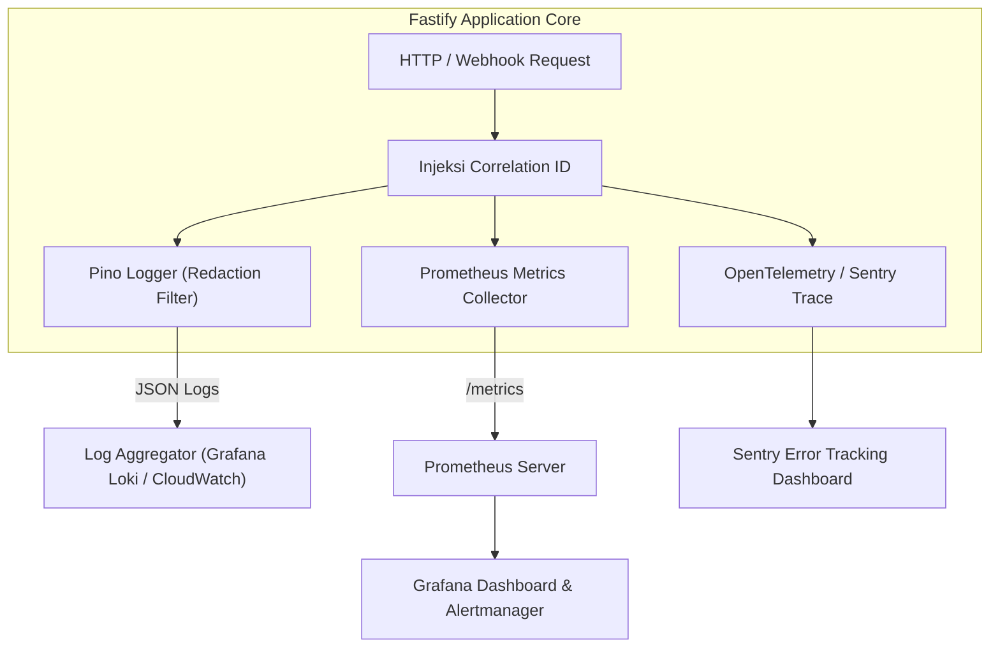
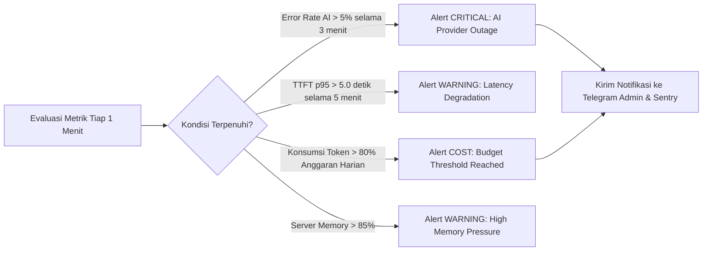

# Monitoring, Logging, & Observability: Multi-Platform General-Purpose AI Assistant

**Versi Dokumen:** 1.0  
**Tanggal:** 7 November 2026  
**Status:** Approved Operations Baseline  
**Referensi:** PRD Section 45 (Monitoring & Logging), NFR-010, TK-005

---

## 1. Observability Pillars Overview

Untuk menjamin ketersediaan sistem ≥ 99.0% dan mendeteksi anomali operasional sedini mungkin, sistem menerapkan 3 pilar observabilitas: **Logs Terstruktur**, **Metrik Kinerja**, dan **Health Checks Real-Time**.



---

## 2. Application Logging Standards (Zero-PII Privacy)

### 2.1 Format Log JSON Terstruktur
Seluruh log aplikasi dicetak dalam format JSON standar menggunakan pustaka logger `Pino`:

```json
{
  "level": "info",
  "time": "2026-11-07T11:45:00.123Z",
  "pid": 1284,
  "hostname": "backend-prod-01",
  "correlation_id": "c1f7b824-3f11-4c12-8854-9405d4b533cb",
  "user_id": "9b1deb4d-3b7d-4bad-9bdd-2b0d7b3dcb6d",
  "platform": "web",
  "event": "ai_inference_complete",
  "provider": "openai",
  "model": "gpt-4o-mini",
  "ttft_ms": 1120,
  "duration_ms": 2840,
  "token_in": 125,
  "token_out": 340,
  "status_code": 200
}
```

### 2.2 Aturan Redaksi Ketat (Logging Redaction Guardrails)
- **Dilarang Keras Mencatat:**
  - Isi teks pesan percakapan (baik teks pengguna maupun jawaban asisten AI).
  - Kata sandi, token verifikasi, session ID, dan kunci API pihak ketiga.
- **Konfigurasi Redaksi Otomatis Pino:**
  ```typescript
  const logger = pino({
    redact: {
      paths: ['req.headers.cookie', 'req.headers.authorization', 'req.body.password', 'req.body.token'],
      censor: '[REDACTED]'
    }
  });
  ```

---

## 3. Metrics Collection & Operational KPIs

Sistem mengekspos metrik operasional pada endpoint terproteksi internal `/metrics` dalam format Prometheus:

| Nama Metrik | Tipe | Deskripsi & Label | Target Operasional |
| :--- | :--- | :--- | :--- |
| `assistant_http_requests_total` | Counter | Total request HTTP per method, path, status | - |
| `assistant_http_duration_seconds` | Histogram | Latensi endpoint API | p95 ≤ 500 ms (Non-AI) |
| `assistant_ai_ttft_seconds` | Histogram | Time to First Token (TTFT) per provider & model | **p95 ≤ 3.0 detik** (OBJ-01) |
| `assistant_ai_tokens_total` | Counter | Total token terpakai (`type="in"` atau `"out"`) | - |
| `assistant_ai_provider_errors_total`| Counter | Total kegagalan API model AI per provider | **Error rate < 2%** (KPI-04) |
| `assistant_active_sessions_gauge` | Gauge | Jumlah pengguna aktif saat ini | - |
| `assistant_quota_exhausted_total` | Counter | Frekuensi pengguna mencapai batas kuota token | - |

---

## 4. Alerting Thresholds & Notification Channels

Grafana Alertmanager dikonfigurasi untuk memicu notifikasi instan (Telegram / Slack Admin / Email) pada skenario berikut:



---

## 5. Health Checks & Probes

Sistem menyediakan dua endpoint pemeriksaan kesehatan:

### 5.1 Liveness Probe (`GET /health/live`)
- **Tujuan:** Memeriksa apakah proses server Fastify masih hidup dan mampu menerima koneksi HTTP.
- **Respons (200 OK):** `{"status": "alive"}`

### 5.2 Readiness Probe (`GET /health/ready`)
- **Tujuan:** Memeriksa apakah seluruh dependensi kritis siap memproses transaksi:
  1. Koneksi PostgreSQL aktif (`SELECT 1`).
  2. Koneksi Redis aktif (`PING -> PONG`).
  3. Konfigurasi kunci API AI valid.
- **Respons (200 OK):**
  ```json
  {
    "status": "ready",
    "checks": {
      "database": "connected",
      "redis": "connected",
      "ai_primary_provider": "operational"
    },
    "timestamp": "2026-11-07T11:45:00.000Z"
  }
  ```
- **Respons (503 Service Unavailable):** Dikeluarkan jika koneksi database atau Redis terputus, sehingga load balancer otomatis berhenti mengarahkan traffic ke container tersebut.

